<div align="center">

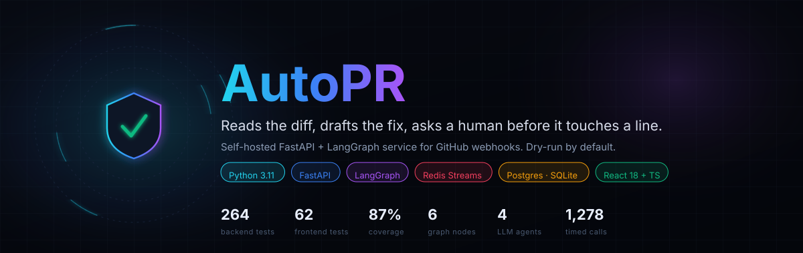

**A multi-agent service that reads your diffs and drafts your fixes — and cannot ship either without you.**

**It ingests signed GitHub webhooks. It reviews the diff, drafts tests, or proposes a patch.**
**Every code-changing action, and every review above `low` risk, is queued for a human.**
**Dry-run by default: out of the box, it touches nothing.**


[Why](#why-this-exists) · [Features](#feature-matrix) · [Architecture](#architecture) · [Trace](#request-trace) · [Measured](#measured-performance) · [Quickstart](#quickstart) · [Config](#configuration) · [API](#api-reference) · [Security](#security-model) · [Deploy](#deployment)

</div>

---

## Table of contents

<details open>
<summary><b>22 sections</b></summary>

| | Section | What is in it |
|---|---|---|
| 1 | [Why this exists](#why-this-exists) | The failure modes, and the code that prevents each one |
| 2 | [Feature matrix](#feature-matrix) | What is built (✅) and what is deliberately not (⬜) |
| 3 | [Architecture](#architecture) | Four-lane diagram + an editable Mermaid copy |
| 4 | [Request trace](#request-trace) | One delivery, end to end, with the short-circuit branches |
| 5 | [How a review is decided](#how-a-review-is-decided) | The gate as a decision tree, with a worked trust-boundary example |
| 6 | [Core pipeline](#core-pipeline) | Job and decision state machines + per-stage guards |
| 7 | [Data model](#data-model) | `erDiagram`, PK/FK, and where vectors vs rows live |
| 8 | [Measured performance](#measured-performance) | 1,008 timed HTTP calls + 270 policy calls, ingestion breakdown, cold-start warning |
| 9 | [Codebase composition](#codebase-composition) | 19,321 lines, counted at generation time |
| 10 | [Repository map](#repository-map) | The 15 files that carry the design |
| 11 | [Quickstart](#quickstart) | Local two-terminal, Docker, and a 60-second smoke test |
| 12 | [Configuration](#configuration) | All 42 settings with real defaults |
| 13 | [API reference](#api-reference) | 11 endpoints, auth column, real payloads |
| 14 | [Security model](#security-model) | 8 layers, each with the function that enforces it |
| 15 | [Quality gates](#quality-gates) | The exact commands and their results |
| 16 | [Deployment](#deployment) | Fly.io, Compose, bare metal |
| 17 | [Troubleshooting](#troubleshooting) | Twelve traps, including the ones in this repo's own history |
| 18 | [Roadmap](#roadmap) | Shipped vs next, with the trade-offs written down |
| 19 | [Contributing](#contributing) | Commands and ground rules |
| 20 | [Regenerating figures](#regenerating-the-figures) | How every chart is rebuilt from data |
| 21 | [Limitations](#limitations-read-this-before-deploying) | What is honestly not done |
| 22 | [License](#license) | MIT |

</details>

---

## Why this exists

LLM code review is easy to demo and dangerous to deploy. The failure modes below are
the ones this repository is actually built around — each row names the function or
test that enforces the claim, so you can check it rather than trust it.

<table>
<tr><th align="left">❌ The typical demo</th><th align="left">✅ This project</th><th align="left">How it is enforced</th></tr>
<tr>
<td>Posts the model's output to your PR immediately.</td>
<td>Runs dry in a recording client and shows you the exact bytes it would post.</td>
<td><code>routing/github.py::FakeGitHubClient</code>; <code>AUTOPR_GITHUB_DRY_RUN=true</code> by default in <code>config.py</code></td>
</tr>
<tr>
<td>Applies a fix because the test went green once.</td>
<td>A verified fix is still only a <em>proposal</em> — the gate is risk-independent for code changes.</td>
<td><code>routing/policy.py::route()</code> returns <code>requires_approval=True</code> for every <code>propose_fix</code></td>
</tr>
<tr>
<td>Two clicks, two comments.</td>
<td>Approval is a compare-and-set; the loser gets <code>409</code>, a later caller gets <code>already_executed</code>.</td>
<td><code>routing/store.py::claim_approval()</code> — a conditional <code>UPDATE … WHERE status='pending'</code></td>
</tr>
<tr>
<td>Redelivered webhooks create duplicate jobs, comments and spend.</td>
<td>One row per <code>repo|pr|sha|action</code>, enforced by a unique index, plus a job ledger that makes a second run a no-op.</td>
<td><code>db.py::insert_ignore_duplicates()</code>, <code>JobResult.job_id</code> PK, <code>tests/test_idempotency.py</code></td>
</tr>
<tr>
<td>A risk score that drifts downward silently re-enables auto-posting.</td>
<td>The gate is sticky: only <code>FAILED</code> is retryable, everything else is terminal for the auto path.</td>
<td><code>routing/store.py</code> + regression test <code>test_risk_downgrade_does_not_bypass_the_human_gate</code></td>
</tr>
<tr>
<td>A dead Redis loses the work that was in flight.</td>
<td>Postgres is the source of truth; a committed-but-unpublished row is repaired by the next delivery and by a reconcile sweep.</td>
<td><code>ingest.py::claim_and_publish()</code>, <code>worker.py::reconcile_pending()</code></td>
</tr>
<tr>
<td>A failing container takes the host down with it.</td>
<td>The patch runs with <code>--network none</code>, non-root, read-only rootfs, memory/CPU/PID caps, hard timeout.</td>
<td><code>sandbox/runner.py</code>; <code>tests/test_sandbox_docker.py</code> proves it in CI</td>
</tr>
<tr>
<td>Tests pass locally because someone's <code>.env</code> is special.</td>
<td>The suite pins its own safety posture before the app is imported.</td>
<td><code>tests/conftest.py</code> — set <em>before</em> any <code>app.*</code> import</td>
</tr>
</table>

---

## Feature matrix

| Area | Capability | Status |
|---|---|---|
| **Ingest** | `pull_request` review track (opened / synchronize) | ✅ |
| | `check_run` + `workflow_run` failure track | ✅ |
| | HMAC-SHA256 verification, constant-time compare | ✅ |
| | 10 MB body cap enforced *before* hashing | ✅ |
| | Dedup on `repo\|pr\|sha\|action` with a unique index | ✅ |
| | Per-IP rate limits (webhook 120/min, mutations 30/min) | ✅ |
| | Optional repo allowlist (deny before insert, zero spend) | ✅ |
| | Per-repo and per-instance job quotas (`429` + `Retry-After`) | ✅ |
| | Read-only public demo mode (approve/reject `403` for everyone) | ✅ |
| | Trusted-proxy `X-Forwarded-For` handling (per-visitor limits) | ✅ |
| **Multi-tenant** | GitHub App auth — per-installation tokens minted on demand, cached | ✅ |
| | Self-serve install: a stranger adds the App to their repos, then opens a PR | ✅ |
| | Suspension / uninstall stop work immediately (separate, reversible states) | ✅ |
| | Per-installation daily quota, so one tenant cannot drain the shared budget | ✅ |
| | Approval from the PR thread: `/autopr approve 42`, no account needed | ✅ |
| | Authority checked against GitHub's own collaborator permissions | ✅ |
| **Reasoning** | `code_reviewer` — findings + risk score | ✅ |
| | `test_generator` — draft tests, never executed | ✅ |
| | `ci_monitor` — failure classification + diagnosis | ✅ |
| | `fix_agent` — minimal unified diff | ✅ |
| | `fix_verifier` — Docker sandbox, deterministic | ✅ |
| | `router` — policy node, deterministic, 0.016 ms | ✅ |
| | Repository RAG over Qdrant, filtered by `ContextVar` | ✅ |
| **Safety** | Dry-run write client by default | ✅ |
| | Human gate for every code change, any risk | ✅ |
| | Risk ceiling for auto-comments (`low`) | ✅ |
| | Sticky decisions, CAS approve, audit log per approval | ✅ |
| | Hand-off mode (never write, give the operator a link) | ✅ |
| **Delivery** | Redis Streams consumer group + PEL reclaim (900 s) | ✅ |
| | Reconcile sweep for stranded `PENDING` rows | ✅ |
| | Bounded retries (`max_attempts=5`) then `DEAD` | ✅ |
| | Exactly-once job ledger (`job_results`) | ✅ |
| **Console** | Overview KPIs, live/dry-run banner | ✅ |
| | Review queue with approve / reject and full body preview | ✅ |
| | Jobs + History with server-side paging, search, filters | ✅ |
| | Token entry in Settings, verified before saving | ✅ |
| | Login / accounts / multi-tenant | ⬜ out of scope |
| **Ops** | `/healthz`, `/readyz`, `/metrics` | ✅ |
| | structlog JSON + `correlation_id` across the queue | ✅ |
| | Alembic migrations + boot-time schema guard | ✅ |
| | Docker Compose stack, Fly.io manifest | ✅ |
| | Horizontal worker scaling | ⬜ deliberately not built |

---

## Architecture

<div align="center">
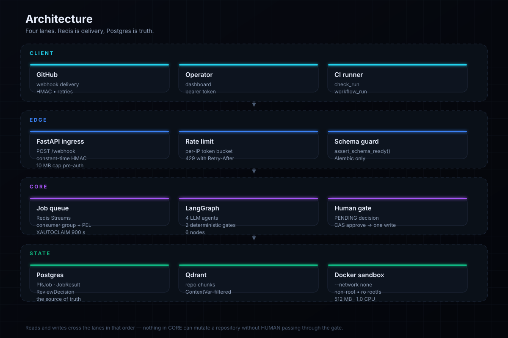
</div>

<details>
<summary><b>Editable Mermaid copy of the same system</b></summary>

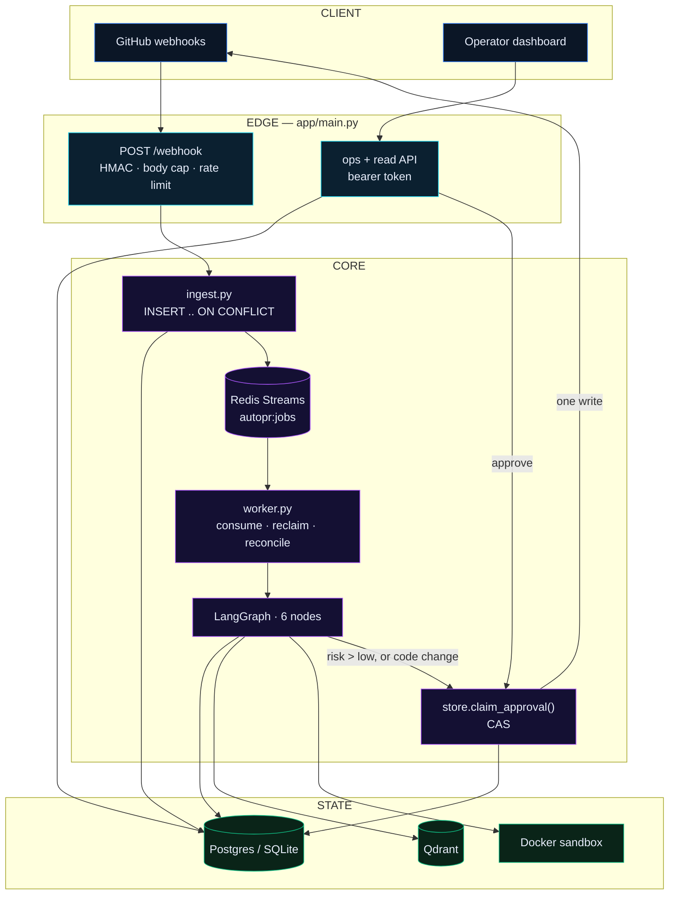

</details>

**Redis is delivery. Postgres is truth.** That split is why the webhook answers in
~25 ms, and why wiping Redis loses no work: `worker.py::reconcile_pending()` re-publishes
every row still sitting in `PENDING`.

---

## Request trace

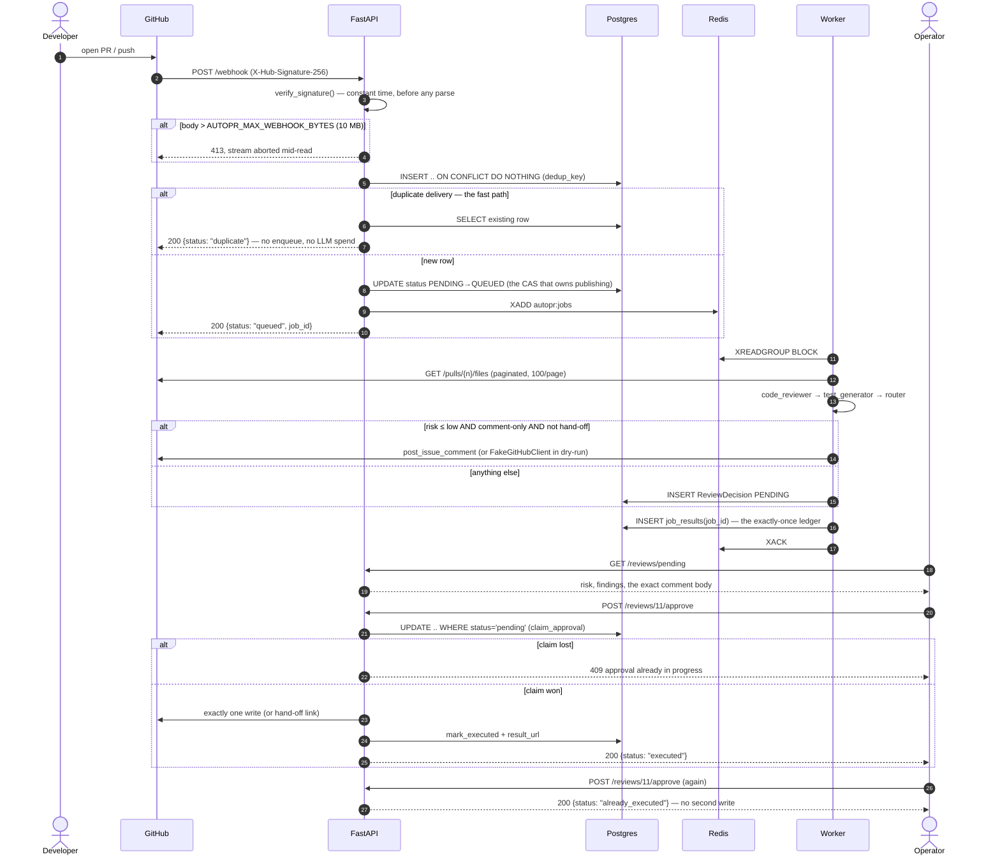

---

## How a review is decided

<div align="center">
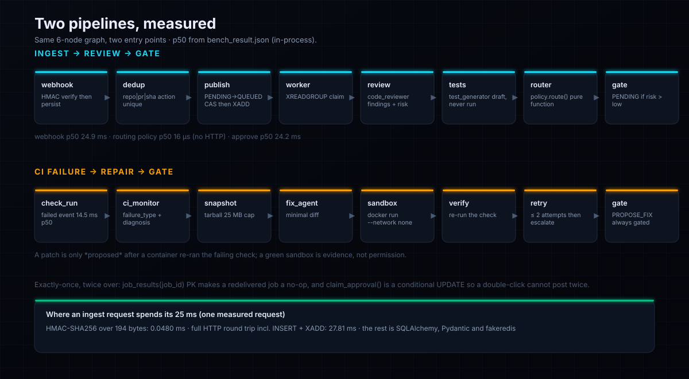
</div>

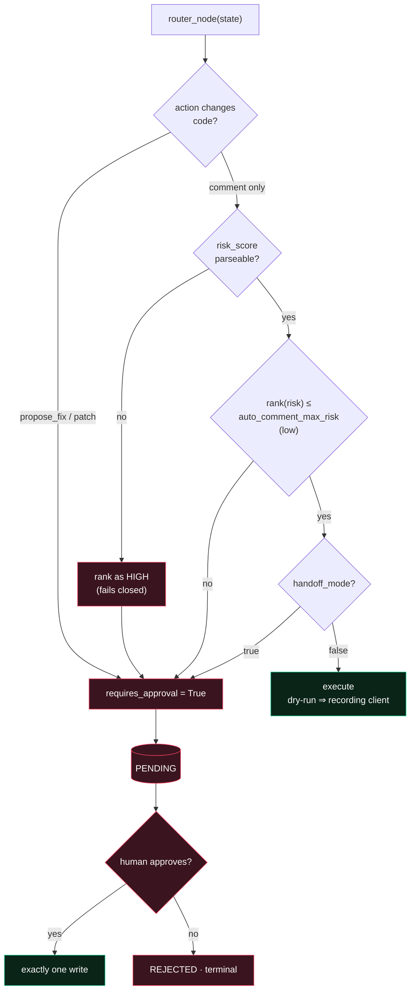

### Worked example of the trust boundary

A `high`-risk review arrives, gets queued, and the model's confidence improves on a
later delivery of the **same** `repo|pr|sha|action`:

| Step | Before the fix (a real bypass) | After |
|---|---|---|
| Delivery 1 | `code_reviewer` says `high` → `PENDING` row created | `PENDING` row created |
| Delivery 2 | Re-routed, model now says `low` → **auto-posted**, the pending row ignored | `PENDING` is terminal for the auto path → still queued |
| Human opens the queue | Two competing outcomes, one already posted | One decision, awaiting one click |

The gate is a state machine, not a score comparison. `tests/test_routing_policy.py`
pins both directions.

---

## Core pipeline

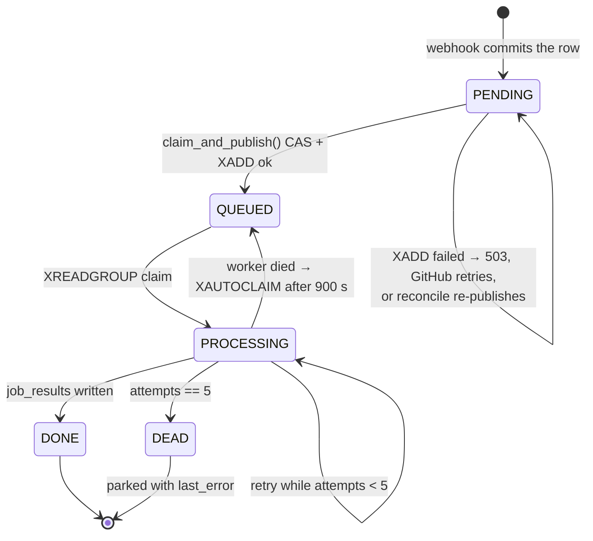

| Stage | What happens | What guards it |
|---|---|---|
| `POST /webhook` | verify → dedup → persist → publish | `security.verify_signature()`, `MAX_WEBHOOK_BYTES`, rate limiter |
| Persist | one row per dedup key | unique index + `insert_ignore_duplicates()` |
| Publish | `PENDING → QUEUED` then `XADD` | `claim_and_publish()` compare-and-set |
| Consume | `XREADGROUP`, ack after the ledger write | consumer group + PEL |
| Graph | 6 nodes, 4 of them LLM | `agents/graph.py::build_graph()` |
| Route | risk + action → auto or gated | `policy.route()` — pure, 0.016 ms, no I/O |
| Gate | `PENDING` row holding the exact body | `store.claim_approval()` CAS |
| Execute | one GitHub call | `routing/github.py` — comment-only surface |

---

## Data model

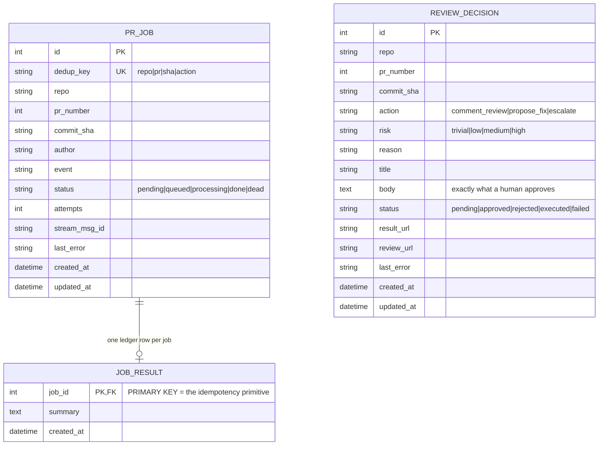

**Rows vs vectors.** Everything a human or a retry depends on is a row in the SQL database:
jobs, the ledger, decisions. Nothing authoritative lives in Redis or Qdrant. Vectors are a
*retrieval cache* — repo chunks in Qdrant, filtered per repository by a `ContextVar` set in
`agents/rag.py`; if Qdrant is down, `rag=None` and the graph runs ungrounded rather than
failing. The dashboard's search is `LIKE` over rows, so it works with the vector store off.

---

## Measured performance

<div align="center">
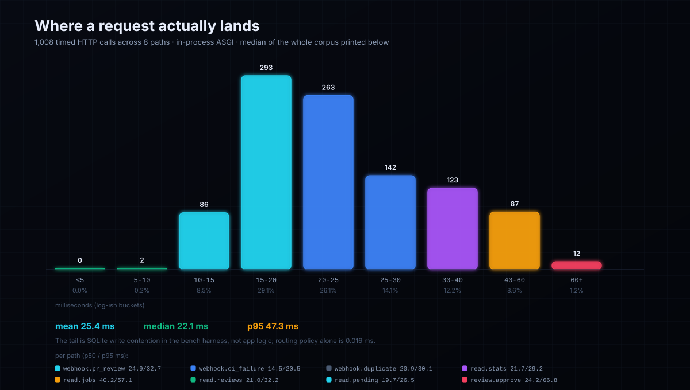
</div>

Measured by `scripts/bench_api.py` → `docs/assets/bench_result.json`. **Method:** the real
ASGI app driven by `TestClient` — real routing, Pydantic validation, HMAC, SQLAlchemy and
routing policy — with `fakeredis` and in-memory SQLite in place of Redis and Postgres.
**No socket, no TLS, no network.** A deployed instance is slower than this; that is the
honest reading. Warm-up: the first 10% of samples are discarded.

| Path | n | p50 | p95 | p99 | max |
|---|---:|---:|---:|---:|---:|
| `POST /webhook` (pull_request) | 180 | **24.9 ms** | 32.7 ms | 36.1 ms | 109.9 ms |
| `POST /webhook` (check_run) | 108 | **14.5 ms** | 20.5 ms | 25.0 ms | 26.1 ms |
| `POST /webhook` (duplicate) | 108 | **20.9 ms** | 30.1 ms | 31.0 ms | 36.3 ms |
| `GET /stats` | 135 | **21.7 ms** | 29.2 ms | 31.3 ms | 32.0 ms |
| `GET /jobs?limit=20` | 135 | **40.2 ms** | 57.1 ms | 89.2 ms | 161.6 ms |
| `GET /reviews?limit=20` | 135 | **21.0 ms** | 32.2 ms | 38.3 ms | 65.5 ms |
| `GET /reviews/pending` | 135 | **19.7 ms** | 26.5 ms | 30.9 ms | 32.1 ms |
| `POST /reviews/{id}/approve` | 72 | **24.2 ms** | 66.8 ms | 152.8 ms | 229.5 ms |
| `policy.route()` (no HTTP) | 270 | **0.016 ms** | 0.025 ms | 0.044 ms | 0.524 ms |

**Where an ingest request spends its 25 ms** (one measured request, 194-byte body):

| Phase | Time | Share |
|---|---:|---|
| HMAC-SHA256 + hex compare | 0.048 ms | ~0.2% |
| HTTP + validation + `INSERT` + CAS + `XADD` + JSON | 27.81 ms | ~99.8% |

The crypto is free. The cost is the database write and the round trip — which is exactly
what you want to know before optimising anything: the security layer is not your bottleneck.

**Reading the tail.** `read.jobs` is the slowest read (p50 40 ms) because it does a
`COUNT(*)` plus a windowed `SELECT` with a `LIKE` filter on one SQLite connection;
approve's p99 is 152 ms because each iteration first re-reads the pending list. Both are
harness artifacts of a single shared connection, not conclusions about Postgres.

> ⚠️ **Cold start, honestly.** First request after boot pays import + connect: expect
> ~1–3 s for the first webhook on a cold container, versus the 25 ms above. Fly.io's
> `min_machines_running = 1` keeps one warm; scale-to-zero will feel slow. The worker's
> first `XREADGROUP` also blocks until a job arrives, by design.

Reproduce it:

```bash
python scripts/bench_api.py                 # writes docs/assets/bench_result.json
python scripts/bench_api.py --scale 3       # 3x samples for a tighter p99
```

### Worker throughput and the cost of the old HTTP client

Measured by `python scripts/bench_optimisations.py` against the real `Worker`,
`JobQueue`, `process_job`, `quota_reason` and client builder.

| Change | Before | After | Why it mattered |
|---|---:|---:|---|
| Worker handles jobs concurrently | 1.02 s for 8×100 ms | **0.36 s (2.8–3.1×)** | Throughput was `1/service_time`; one slow job stalled the queue |
| One pooled HTTP client per process | 291 ms/call | **7.8 ms/call** | `httpx.Client()` construction alone is 273 ms (SSL context + pool) and the old code built one per call — 4–7 per job, ≈1.4 s of pure overhead |
| Indexes for the quota `COUNT`s (200k rows) | 117 ms (`SCAN`) | **1.1 ms (covering index)** | An unindexed `COUNT` costs a scan that grows with *history*, not load |

Concurrency is only safe because `process_job` **claims** a job with a conditional
`UPDATE` first; without it, parallel handling double-posts. That is verified by removing
the guard: `python scripts/negative_control_claim.py` disables the claim and the failure
release and asserts the tests that pin them fail. Full reasoning, including the two
defects this work exposed (a leaked claim on handler failure, and a naive-datetime crash
inside the ORM-evaluated `UPDATE`), is in
[`docs/decisions/phase-17.md`](docs/decisions/phase-17.md).

Phase 18 crossed the boundary that reasoning cannot: **8 separate operating-system processes,
one real Postgres, one job — one run.** Seven tests pin it, including the negative control
that a *live* lease is not stolen, so "the stale lease was reclaimed" cannot pass for a claim
that ignores `updated_at` altogether. Same phase: the migration cycle is now asserted
(`downgrade base` leaves **no tables**; models and migrations do not drift), and the App chain
became a single command. Details, including the two harness bugs that looked exactly like
product bugs: [`docs/decisions/phase-18.md`](docs/decisions/phase-18.md).

The last two rows are loopback and SQLite: they measure client construction, protocol
overhead and query plan shape. They are **not** WAN latency or Postgres timings.

### Capacity, with its assumptions showing

`scripts/capacity_plan.py` turns those measurements into a fleet size (Little's law:
`workers ≥ λ·S / utilisation`). Two of its inputs cannot be measured here — provider
latency and token price — so it prints both as **ASSUMPTION** and warns until you pass
`--llm-latency-ms` from ten timed reviews.

| tenants | jobs/day | peak jobs/h | workers | USD/day | storage GB/mo |
|---:|---:|---:|---:|---:|---:|
| 10 | 43 | 8.6 | 1 | 0.04 | 0.01 |
| 100 | 429 | 85.7 | 1 | 0.44 | 0.07 |
| 1,000 | 4,286 | 857.1 | 3 | 4.36 | 0.66 |

It also names the **binding constraint** and how full it is: at 1,000 tenants the top
tier sits at **1.59%** of its published ceiling, so the honest reading is "set by
queueing, not by a limit" — and the tool says that instead of implying saturation.
Storage is steady state (retention-capped), not cumulative. `tests/test_capacity.py`
keeps the inputs honest: the ingest figures must track `bench_result.json`, cost must
equal tokens × price, and unmeasured inputs must stay labelled.

---

## Codebase composition

<div align="center">
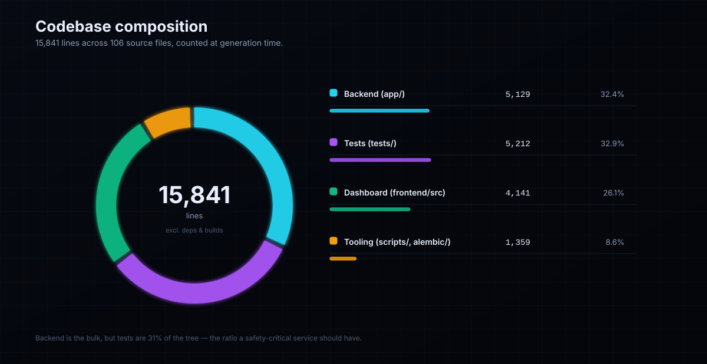
</div>

| Area | Lines | Files | Share |
|---|---:|---:|---:|
| Backend (`app/`) | 7,319 | 36 | 31.8% |
| Tests (`tests/`) | 8,875 | 45 | 38.6% |
| Dashboard (`frontend/src`) | 4,205 | 37 | 18.3% |
| Tooling (`scripts/`, `alembic/`) | 2,603 | 12 | 11.3% |
| **Total** | **23,002** | **130** | **100%** |

Counted by `docs/assets/generate.py::line_counts()` on every run — the donut cannot drift
from the tree. Tests are 35% of the codebase, which is the ratio a service whose failure
mode is "writes to your repository" should have.

---

## Repository map

<div align="center">
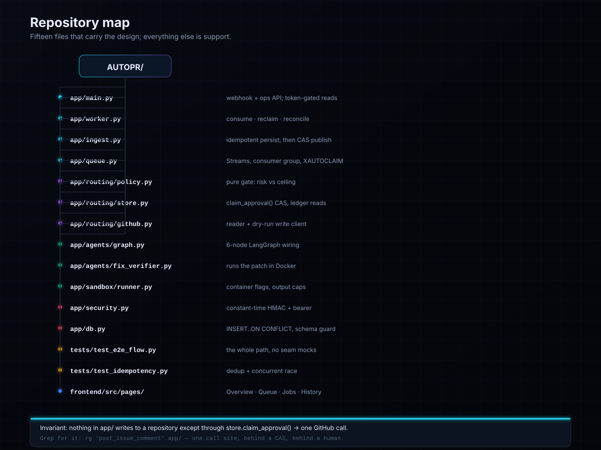
</div>

<details>
<summary><b>Plain tree with line counts</b></summary>

```text
AUTOPR/                                    19,321 lines · 117 files
├── app/                                    5,067
│   ├── main.py                               733   webhook + ops API + reads
│   ├── worker.py                             413   consume · reclaim · reconcile
│   ├── ingest.py                             345   idempotent persist → CAS publish
│   ├── config.py                             244   42 settings + fail-fast validators
│   ├── queue.py                              176   Streams, group, XAUTOCLAIM
│   ├── models.py                             173   PRJob · JobResult · ReviewDecision
│   ├── db.py                                 158   INSERT..ON CONFLICT, schema guard
│   ├── observability.py                      113   structlog + correlation_id
│   ├── ratelimit.py                           71   per-IP token buckets
│   ├── security.py                            53   constant-time HMAC + bearer
│   ├── routing/
│   │   ├── github.py                         349   reader + dry-run write client
│   │   ├── policy.py                         273   the gate, as a pure function
│   │   ├── store.py                          272   claim_approval() CAS, ledger reads
│   │   └── router.py                         217   the LangGraph routing node
│   ├── agents/
│   │   ├── rag.py                            219   Qdrant retrieval, ContextVar scope
│   │   ├── graph.py                          148   6-node graph wiring
│   │   ├── fix_agent.py                      116   minimal unified diff
│   │   ├── code_reviewer.py                  115   findings + risk
│   │   ├── common.py                         112   shared prompt/parse helpers
│   │   ├── ci_monitor.py                      95   failure classification
│   │   ├── test_generator.py                  85   draft tests, never executed
│   │   ├── state.py                           64   the typed graph state
│   │   └── llm.py                             41   Groq client factory
│   └── sandbox/{runner,verifier,policy}.py    450   container flags and caps
├── tests/                                   7,053  409 tests in 39 files
├── frontend/src/                           4,141   9 test files, 4 routes, typed client
├── docs/                                           architecture · operations · api · 14 ADRs
├── docs/assets/                                    generate.py + 6 SVGs + bench_result.json
├── scripts/bench_api.py                             this README's latency numbers
├── scripts/load_test.py                             live load test, non-zero exit on regression
├── alembic/                                  218   the only schema owner
├── docker/sandbox.Dockerfile                       the CI-fix sandbox image
└── Dockerfile · docker-compose.yml · fly.toml
```

</details>

---

## Quickstart

**Prerequisites:** Python 3.11 (via [uv](https://docs.astral.sh/uv/)), Node 20+.
Docker only for the Compose stack or the CI-fix sandbox.

### Path A — local, two terminals (SQLite, no infra)

```bash
cp .env.example .env
python -c "import secrets; print(secrets.token_hex(32))"   # paste into AUTOPR_WEBHOOK_SECRET
python -c "import secrets; print(secrets.token_hex(32))"   # paste into AUTOPR_API_TOKEN

uv sync --extra dev
uv run alembic upgrade head                       # the app refuses to boot unmigrated
AUTOPR_LOG_JSON=false uv run uvicorn app.main:app --reload --port 8000
```

```bash
uv run python scripts/seed_demo.py                # ~10 jobs + a populated review queue
cd frontend && npm ci && npm run dev              # http://localhost:5173
```

No Redis? The API logs `startup.queue_unavailable`, `/readyz` reports `degraded`, and the
webhook answers **503** so GitHub retries — while the dashboard's reads keep working off
the database. That is the designed degradation, not a crash.

### Path B — everything in Docker

```bash
cp .env.example .env     # set AUTOPR_WEBHOOK_SECRET and AUTOPR_API_TOKEN
docker compose up --build
```

Brings up Postgres, Redis, Qdrant, the API (running `alembic upgrade head` first) and the
worker. See [`docs/operations.md`](docs/operations.md).

### 60-second smoke test

```bash
# 1. liveness + readiness (readiness tells you which dependency is down)
curl -s localhost:8000/healthz; echo; curl -s localhost:8000/readyz; echo

# 2. a signed delivery, exactly as GitHub would send it
BODY='{"action":"opened","pull_request":{"number":1,"head":{"sha":"deadbeef"},"user":{"login":"you"}},"repository":{"full_name":"you/demo"}}'
SIG=$(python -c "import hmac,hashlib,os,sys;print('sha256='+hmac.new(os.environ['AUTOPR_WEBHOOK_SECRET'].encode(),sys.argv[1].encode(),hashlib.sha256).hexdigest())" "$BODY")
curl -s -X POST localhost:8000/webhook -H "X-GitHub-Event: pull_request" \
  -H "X-Hub-Signature-256: $SIG" -H 'Content-Type: application/json' -d "$BODY"
# → {"status":"queued","job_id":1}
# send the identical body again → {"status":"duplicate"} (proves dedup)

# 3. the worker's verdict, and the human gate
curl -s localhost:8000/jobs | head -c 400; echo
curl -s localhost:8000/reviews/pending | head -c 500; echo

# 4. approve it — twice. The second call must not write again.
curl -s -X POST localhost:8000/reviews/1/approve -H "Authorization: Bearer $AUTOPR_API_TOKEN"; echo
curl -s -X POST localhost:8000/reviews/1/approve -H "Authorization: Bearer $AUTOPR_API_TOKEN"; echo
# → {"status":"already_executed"}
```

---

## Install it on someone else's repo

This is the difference between "my bot" and "a bot". With GitHub App credentials configured,
anyone can install AutoPR on their own repositories and never see a token, a dashboard login, or
an operator.

**Setup (operator, once).** Register a GitHub App → point its webhook at
`https://your-host/webhook` with the same `AUTOPR_WEBHOOK_SECRET`, grant *Contents: read*,
*Pull requests: read*, *Issues: write* → subscribe to `pull_request`,
`check_run`, `workflow_run`, `issue_comment`, `installation`, `installation_repositories` → put
the App id and the downloaded `.pem` into `AUTOPR_GITHUB_APP_ID` and
`AUTOPR_GITHUB_APP_PRIVATE_KEY` (one line, escaped newlines accepted) → set
`AUTOPR_QUOTA_JOBS_PER_INSTALLATION_PER_DAY`. That's it: `AUTOPR_GITHUB_APP_SLUG` publishes the
install link at `GET /installations` and `GET /stats`.

Those three permissions are the whole list, and they are derived from the API calls rather than
guessed: `pulls/{n}/files` (read the diff), `tarball/{ref}` (snapshot for the sandbox), and
`issues/{n}/comments` (the one write). **No `Checks` access** — CI failure logs arrive inline in
the webhook payload, so the API is never asked for them. Full walkthrough: **[docs/install.md](docs/install.md)**.

**Then a customer's whole experience is this:**

```
1. Install  →  github.com/apps/<your-slug>/installations/new   (their choice of repos)
2. Open a PR                                                   (nothing else to configure)
3. 30 s later a review appears on the PR
4. If it proposes a change, the bot says so and waits:
   "Action queued for approval · #42"   →   /autopr approve 42
```

No signup, no token, no email. Step 4 is the human gate: the action fires only if GitHub says the
commenter has `admin`, `maintain` or `write` on that repo — and it fires with *their*
installation's token, on *their* quota.

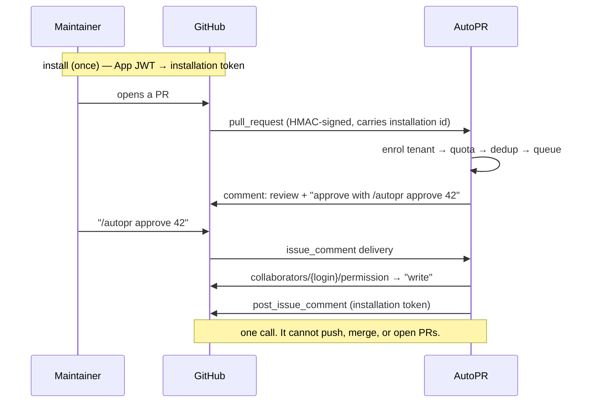

Tenants are visible to the operator at `GET /installations` — id, account, active/suspended,
jobs and pending reviews — which is also how you answer "who is using the budget?".

## Configuration

42 settings, all `AUTOPR_`-prefixed, all defined in [`app/config.py`](app/config.py). The app
**refuses to start** on the placeholder webhook secret *or* an empty API token unless
`AUTOPR_ALLOW_INSECURE=1`. Both are settings whose absence is silent at request time and
catastrophic in effect: a forgeable webhook, and an `/approve` endpoint that answers anyone.

<details open>
<summary><b>Safety and behaviour — the ones that change what the bot can do</b></summary>

| Variable | Required | Default | Purpose |
|---|---|---|---|
| `AUTOPR_WEBHOOK_SECRET` | ✅ | *placeholder* | HMAC key for deliveries. Startup fails if left at the placeholder. |
| `AUTOPR_API_TOKEN` | ✅ | *(empty)* | Bearer token for approve/reject. **Empty = startup failure** (dev override: `ALLOW_INSECURE`). |
| `AUTOPR_GITHUB_DRY_RUN` | ⬜ | `true` | Master switch. `true` = record the intended call, touch nothing. |
| `AUTOPR_HANDOFF_MODE` | ⬜ | `false` | `true` = never write; approvals return a PR link instead. |
| `AUTOPR_AUTO_COMMENT_MAX_RISK` | ⬜ | `low` | Ceiling for *auto-posting comments*. Never covers code changes. |
| `AUTOPR_GITHUB_TOKEN` | ⬜ | *(empty)* | Enables live reads/writes. Only meaningful with dry-run off. |
| `AUTOPR_REQUIRE_AUTH_FOR_READS` | ⬜ | `false` | Gate `/jobs`, `/reviews`, `/stats` behind the token too. **Set true on any internet-reachable instance.** |
| `AUTOPR_ALLOWED_REPOS` | ⬜ | *(empty)* | Comma-separated `owner/name` allowlist. Empty = any repo with a signed webhook. Set it on public repos, or fork PRs bill your LLM key. |
| `AUTOPR_GITHUB_APP_ID` | ⬜ | — | GitHub App id. With the private key, switches the instance to multi-tenant. |
| `AUTOPR_GITHUB_APP_PRIVATE_KEY` | ⬜ | — | The App's `.pem` content; a single line with `
` escapes is accepted. |
| `AUTOPR_GITHUB_APP_SLUG` | ⬜ | — | Public App slug; publishes the self-serve install link in `/stats` + `/installations`. |
| `AUTOPR_QUOTA_JOBS_PER_INSTALLATION_PER_DAY` | ⬜ | `0` (off) | Per-tenant daily ceiling, so one installation cannot drain the shared budget. Required when public mode is on. |
| `AUTOPR_GITHUB_COMMENT_COMMANDS` | ⬜ | `true` | `/autopr approve` in the PR thread — the only approval path a tenant has. |
| `AUTOPR_PUBLIC_MODE` | ⬜ | `false` | Read-only public demo. Refuses to boot unless allowlist + dry-run + quotas are set; then approve/reject return 403 for *everyone*. |
| `AUTOPR_QUOTA_JOBS_PER_REPO_PER_HOUR` | ⬜ | `0` (off) | Soft cost ceiling per repo per hour, answered `429` + `Retry-After`. Required > 0 in public mode. |
| `AUTOPR_QUOTA_JOBS_TOTAL_PER_DAY` | ⬜ | `0` (off) | Soft instance-wide daily ceiling; the bound a stranger cannot escape. Required > 0 in public mode. |
| `AUTOPR_TRUSTED_PROXIES` | ⬜ | *(empty)* | IPs/CIDRs of proxies whose `X-Forwarded-For` we believe. Empty = header ignored, because a direct client could forge a bucket per request. |
| `AUTOPR_ALLOW_INSECURE` | ⬜ | `false` | Local/dev/test escape hatch for *both* fail-fast checks. |
| `AUTOPR_CORS_ORIGINS` | ⬜ | local dev origins | Comma-separated allowlist for the dashboard origin. |

</details>

<details>
<summary><b>Ingress, rate limits, storage</b></summary>

| Variable | Required | Default | Purpose |
|---|---|---|---|
| `AUTOPR_MAX_WEBHOOK_BYTES` | ⬜ | `10000000` | Body cap, enforced while streaming and before HMAC. |
| `AUTOPR_RATE_LIMIT_ENABLED` | ⬜ | `true` | Per-IP token buckets. |
| `AUTOPR_RATE_LIMIT_WEBHOOK_PER_MIN` | ⬜ | `120` | Webhook budget per IP per minute. |
| `AUTOPR_RATE_LIMIT_MUTATIONS_PER_MIN` | ⬜ | `30` | Approve/reject budget per IP per minute. |
| `AUTOPR_DATABASE_URL` | ⬜ | `sqlite+pysqlite:///./autopr.db` | SQLite locally; `postgresql+psycopg://…` in Compose/cloud. |
| `AUTOPR_REDIS_URL` | ⬜ | `redis://localhost:6379/0` | Queue backend. |
| `AUTOPR_REDIS_SOCKET_TIMEOUT_S` | ⬜ | `10` | Socket timeout. |
| `AUTOPR_REDIS_CONNECT_TIMEOUT_S` | ⬜ | `5` | Connect timeout. |
| `AUTOPR_REDIS_HEALTH_CHECK_INTERVAL_S` | ⬜ | `30` | Health-check interval. |
| `AUTOPR_STREAM_NAME` | ⬜ | `autopr:jobs` | Stream key. |
| `AUTOPR_CONSUMER_GROUP` | ⬜ | `autopr-workers` | Consumer group name. |
| `AUTOPR_GITHUB_API_URL` | ⬜ | `https://api.github.com` | Override for GitHub Enterprise. |

</details>

<details>
<summary><b>Queue semantics and retries</b></summary>

| Variable | Required | Default | Purpose |
|---|---|---|---|
| `AUTOPR_MAX_ATTEMPTS` | ⬜ | `5` | Exactly this many executions, then `DEAD`. |
| `AUTOPR_RECLAIM_IDLE_MS` | ⬜ | `900000` | Idle window before another worker may `XAUTOCLAIM`. Warns below 5 min. |
| `AUTOPR_RECONCILE_INTERVAL_S` | ⬜ | `60` | How often the worker re-publishes stranded `PENDING` rows. |

</details>

<details>
<summary><b>LLM and retrieval</b></summary>

| Variable | Required | Default | Purpose |
|---|---|---|---|
| `AUTOPR_GROQ_API_KEY` | ⬜ | *(empty)* | Powers the 4 LLM agents. Empty = graph runs with canned/deterministic agents in tests. |
| `AUTOPR_LLM_MODEL` | ⬜ | *(empty)* | Model id. Empty = the client's default. |
| `AUTOPR_LLM_TIMEOUT_S` | ⬜ | `30` | Per-call timeout. |
| `AUTOPR_QDRANT_URL` | ⬜ | `http://localhost:6333` | Vector store. |
| `AUTOPR_RAG_ENABLED` | ⬜ | `false` | Ground reviews in repository chunks. |

</details>

<details>
<summary><b>Sandbox and snapshot caps</b></summary>

| Variable | Required | Default | Purpose |
|---|---|---|---|
| `AUTOPR_SANDBOX_IMAGE` | ⬜ | `autopr-sandbox:latest` | Image the patch is verified in. |
| `AUTOPR_DOCKER_BIN` | ⬜ | *(auto)* | Explicit docker binary path. |
| `AUTOPR_SANDBOX_TIMEOUT_S` | ⬜ | `120` | Hard container timeout. |
| `AUTOPR_SANDBOX_MEMORY` | ⬜ | `512m` | Memory cap. |
| `AUTOPR_SANDBOX_CPUS` | ⬜ | `1.0` | CPU cap. |
| `AUTOPR_SANDBOX_PIDS_LIMIT` | ⬜ | `256` | Fork-bomb guard. |
| `AUTOPR_MAX_FIX_ATTEMPTS` | ⬜ | `2` | Patch attempts before escalation to a human. |
| `AUTOPR_SNAPSHOT_MAX_FILE_BYTES` | ⬜ | `1000000` | Per-file cap while streaming a snapshot. |
| `AUTOPR_SNAPSHOT_MAX_FILES` | ⬜ | `2000` | File-count cap. |
| `AUTOPR_SNAPSHOT_MAX_TOTAL_BYTES` | ⬜ | `25000000` | Extracted total cap. |
| `AUTOPR_SNAPSHOT_MAX_TARBALL_BYTES` | ⬜ | `100000000` | Mid-stream tarball cap — aborts *while arriving*. |

</details>

<details>
<summary><b>Observability</b></summary>

| Variable | Required | Default | Purpose |
|---|---|---|---|
| `AUTOPR_LOG_JSON` | ⬜ | `true` | JSON logs (`false` = human-readable locally). |
| `AUTOPR_METRICS_ENABLED` | ⬜ | `true` | Exposes `/metrics`. |

</details>

---

## API reference

Eleven endpoints. Auth column is literal: what the dependency is doing right now.

| Method | Path | Auth | Returns |
|---|---|---|---|
| `GET` | `/healthz` | none | liveness; never touches a dependency |
| `GET` | `/readyz` | none | per-dependency readiness (`degraded` if Redis is down) |
| `GET` | `/metrics` | none | Prometheus text format |
| `POST` | `/webhook` | **HMAC-SHA256** + rate limit | `queued` / `duplicate` / `ignored` |
| `GET` | `/reviews/pending` | token if `REQUIRE_AUTH_FOR_READS` | `{count, pending[]}` |
| `POST` | `/reviews/{id}/approve` | **bearer** + mutation limit | `executed` / `already_executed` / `handed_off` / `409` |
| `POST` | `/reviews/{id}/reject` | **bearer** + mutation limit | `rejected` / `already_rejected` / `409` |
| `GET` | `/stats` | token if reads gated | KPI counters for the dashboard |
| `GET` | `/jobs` | token if reads gated | `Page[Job]` — `count/total/limit/offset` |
| `GET` | `/reviews` | token if reads gated | `Page[Review]` — same envelope |
| `GET` | `/installations` | token if reads gated | tenants, active state, job + pending counts, install URL |

<details>
<summary><b>POST /webhook — request and response</b></summary>

```http
POST /webhook HTTP/1.1
X-GitHub-Event: pull_request
X-Hub-Signature-256: sha256=5f1c…   # HMAC-SHA256 of the raw body
Content-Type: application/json
```
```json
{"action":"opened","pull_request":{"number":42,"head":{"sha":"9f2a"},"user":{"login":"you"}},
 "repository":{"full_name":"acme/api"}}
```
```json
{"status":"queued","job_id":17}
```
`status` is one of `queued` (new job), `duplicate` (dedup key already exists — no work
done), `ignored` (event type we do not act on). Read `job_id` to follow the job in `/jobs`.

</details>

<details>
<summary><b>GET /reviews/pending — what the operator sees</b></summary>

```json
{"count":1,"pending":[{"id":11,"repo":"acme/api","pr_number":42,"commit_sha":"9f2a",
  "action":"comment_review","risk":"high","status":"pending",
  "title":"Review: acme/api #42","body":"## AutoPR review\n…","review_url":"…/pull/42/files"}]}
```
`body` is **the exact text that will be posted** if you approve — not a summary of it.
That is the point of the queue: you approve bytes, not intentions. Read `risk` and
`action` first: `propose_fix` never auto-executes, whatever the risk.

</details>

<details>
<summary><b>POST /reviews/{id}/approve — the CAS</b></summary>

```bash
curl -X POST localhost:8000/reviews/11/approve -H "Authorization: Bearer $TOKEN"
```
```json
{"status":"executed","url":"https://github.com/acme/api/pull/42#issuecomment-1","decision":{…}}
```
| Response | Meaning |
|---|---|
| `executed` | you won the claim, exactly one write happened |
| `already_executed` | a previous approval already did it — safe to see this on a retry |
| `handed_off` | hand-off mode: no write, `review_url` is yours to finish |
| `409` | someone else holds the claim right now |
| `404` | no such decision |

</details>

<details>
<summary><b>GET /jobs and /reviews — the Page envelope</b></summary>

```bash
curl "localhost:8000/jobs?q=acme&status=done&limit=20&offset=0"
```
```json
{"count":2,"total":37,"limit":20,"offset":0,"jobs":[{"id":17,"status":"done","attempts":1}]}
```
`count` is this page, `total` is the filtered set. The dashboard prints "1–20 of 37" from
these two numbers rather than guessing, and refetches immediately when the query changes.

</details>

---

## Security model

| Layer | Control | Where |
|---|---|---|
| Transport | TLS terminated by the platform; no plaintext secrets in the image | deploy config, `.env` (gitignored) |
| Authenticity | HMAC-SHA256 over the raw body, `compare_digest` (constant time) | `security.py::verify_signature()` |
| Resource abuse | 10 MB body cap enforced **before** the HMAC; per-IP buckets; 429 + `Retry-After` | `main.py::_webhook_rl`, `ratelimit.py` |
| Authorization | Bearer token for mutations, constant-time compare, optional for reads | `security.py::require_api_token()` |
| Fail-fast config | Refuses to boot on the placeholder secret **or** an empty API token — neither misconfig can survive to request time | `config.py::_enforce_secure_config` (`test_secure_boot.py`) |
| Cost containment | Optional `owner/name` allowlist; a signed delivery from an unlisted repo is answered `ignored` before the INSERT, so it costs no row, no enqueue and no LLM call | `ingest.py::repo_is_allowed`, `main.py` webhook route |
| Public posture | `AUTOPR_PUBLIC_MODE` makes approve/reject 403 for everyone (operator token included) and forces allowlist + dry-run + quotas at boot | `config.py::_enforce_public_mode`, `main.py` approve/reject |
| Spend ceiling | Per-repo/hour and instance/day job quotas, checked before the INSERT; a refusal costs no row and no model call | `quota.py::quota_reason` (`test_public_mode.py`) |
| Client identity | `X-Forwarded-For` honoured only when the socket peer is a declared trusted proxy, walking the chain from the right | `ratelimit.py::resolve_client_ip` (`test_client_ip.py`) |
| Tenant credentials | App JWT (RS256, 9 min) mints per-installation tokens; cached until 60 s before expiry. No instance-wide repo credential exists in multi-tenant mode | `github_app.py::AppAuth` (`test_tenancy.py`) |
| Tenant attribution | Every write resolves the owning installation from the repo; if the App is not installed there, the write is **refused** rather than falling back to a PAT | `github_app.py::TenantGitHubClient` |
| Approval identity | The commenter's login from an HMAC-signed payload, plus a live collaborator-permission check (admin/maintain/write). AutoPR keeps no ACL of its own | `commands.py` (`test_commands.py`) |
| Cross-tenant access | A decision is addressable only by its own installation **and** its own repo; ids from elsewhere answer "no such decision" | `commands.py::_decision_for` |
| Tenant lifecycle | `suspend` pauses, `deleted` is terminal and cannot be revived by a replayed `created` event | `tenancy.py::apply_event` |
| Write surface | The client exposes exactly one write: `post_issue_comment` | `tests/test_github_client.py::test_write_surface_is_comment_only` |
| Human approval | CAS claim, terminal states, audit log with actor IP | `routing/store.py::claim_approval()` |
| Code execution | `--network none`, non-root, read-only rootfs, memory/CPU/PID caps, timeout | `sandbox/runner.py` |
| Path handling | Snapshot extraction contained with `is_relative_to` | `sandbox/` + tests |
| Supply chain | Pinned `uv.lock` + `package-lock.json`, no unpinned installs in CI | lockfiles |

**Two postures, and you pick one.** A *private* instance (the default) answers reads anonymously and
lets any repo with a signed webhook create work; that is fine because nobody else can reach it. A
*public* instance (`AUTOPR_PUBLIC_MODE=true`) keeps reads open — a demo nobody can read is not a
demo — but closes every write path to every caller, forces dry-run, and will not start without an
allowlist and two positive quotas. Those three invariants are checked at boot, not warned about,
because each one turns a demo into either a free LLM proxy for strangers or a remote code-change
service for whoever finds the URL. `AUTOPR_API_TOKEN` being empty is a boot failure in both
postures; `AUTOPR_TRUSTED_PROXIES` is what keeps the per-IP limiter honest behind a proxy.

**Two tenancy shapes.** Without App credentials this remains a *single-operator* tool: one
bearer token, one operator, the dashboard meant to sit behind your own SSO proxy. With
`AUTOPR_GITHUB_APP_ID` + a private key it becomes *multi-tenant*: each installation gets its own
minted token, its own rows, its own quota, and its own approval thread. What it still has no
concept of is a **user account** — there is no login, no session, and no per-person attribution
beyond "GitHub says this login has write access to this repo". That is the deliberate trade: an
identity we can never get wrong because we never store it.

**Threat model, stated plainly.** Strangers are now in scope by design, and exactly three things
bound them: the installation token (their repos only), the human gate (nothing code-changing
fires without a permission-checked human), and the quotas (spend is capped per repo, per tenant,
per instance). The residual risks are named rather than hidden: a leaked App private key mints
tokens for every installation until it is rotated, the webhook secret is shared by all tenants
(one leak is instance-wide), and a prompt-injected diff could still produce a `low`-risk review
that auto-posts attacker-chosen *text* as a comment — never code, never a push.

---

## Quality gates

<table>
<tr><th align="left">Gate</th><th align="left">Command</th><th align="left">Result</th></tr>
<tr><td>Backend tests</td><td><code>uv run pytest</code></td><td><b>478 passed, 5 skipped</b> (480 when a Docker daemon is running) &mdash; 483 collected</td></tr>
<tr><td>Cross-process claiming</td><td><code>pytest tests/test_worker_multiprocess.py</code></td><td><b>7 passed against a real Postgres</b> &mdash; 8 OS processes racing one job run the handler <b>once</b>; a crashed worker hands the row back to another <em>process</em>; a live lease is not stolen (negative control)</td></tr>
<tr><td>Concurrency safety</td><td><code>python scripts/negative_control_claim.py</code></td><td><b>2 negative controls</b> &mdash; disabling the job claim or the failure release turns 2&ndash;3 tests red, and each control restores <code>app/worker.py</code> byte-identically</td></tr>
<tr><td>Optimisation benchmark</td><td><code>python scripts/bench_optimisations.py</code></td><td><b>2.8&ndash;3.1&times;</b> worker throughput, <b>37&times;</b> per GitHub call, <b>106&times;</b> quota check &mdash; each measured against the real code, not a stand-in</td></tr>
<tr><td>Capacity model</td><td><code>python scripts/capacity_plan.py</code> + <code>pytest tests/test_capacity.py</code></td><td><b>21 tests</b> &mdash; measured inputs track the bench artifact, cost equals tokens &times; price, and every unmeasured input is labelled ASSUMPTION in the output</td></tr>
<tr><td>Security guards</td><td><code>uv run pytest tests/test_secure_boot.py tests/test_public_mode.py tests/test_client_ip.py</code></td><td><b>42 passed</b> across the three hardenings &mdash; token, allowlist, public mode, quotas, client IP &mdash; each with a negative control that proves the test fails when the guard is removed</td></tr>
<tr><td>Coverage</td><td><code>uv run pytest --cov=app</code></td><td><b>88%</b> (gate 78%)</td></tr>
<tr><td>Lint</td><td><code>ruff check app tests scripts docs/assets/generate.py</code></td><td><b>86 files, clean</b></td></tr>
<tr><td>Format</td><td><code>ruff format --check</code></td><td><b>clean</b></td></tr>
<tr><td>Types (backend)</td><td><code>mypy app</code></td><td><b>36 files, no issues</b></td></tr>
<tr><td>Frontend tests</td><td><code>npm test</code></td><td><b>63 passed</b> / 9 files</td></tr>
<tr><td>Types (frontend)</td><td><code>tsc -b</code></td><td><b>clean</b></td></tr>
<tr><td>Lint (frontend)</td><td><code>eslint --max-warnings 0</code></td><td><b>clean</b></td></tr>
<tr><td>Format (frontend)</td><td><code>prettier --check</code></td><td><b>clean</b></td></tr>
<tr><td>Migrations</td><td>alembic up → down → up on real Postgres</td><td><b>green in CI</b>, plus <b>3 assertions</b> (<code>tests/test_migrations_postgres.py</code>): the downgrade leaves <b>no tables</b>, models and migrations have <b>not drifted</b>, re-running is a no-op</td></tr>
<tr><td>Installation verifier</td><td><code>python scripts/verify_installation.py</code></td><td><b>16 tests</b> pinning every failure mode; one command runs the real chain (JWT &rarr; installation token &rarr; repo access &rarr; permission &rarr; optional comment) against a real App</td></tr>
<tr><td>Docs &amp; figures</td><td><code>pytest tests/test_docs_assets.py</code></td><td><b>17 passed</b> — figures match the tree, audit is clean, numbers do not drift</td></tr>
<tr><td>Sandbox boundary</td><td><code>ci.yml</code> &rarr; <code>sandbox</code> job</td><td>Builds the image, runs the 2 Docker-gated tests and <b>fails on <code>skipped</code></b> &mdash; a laptop may skip them, that job may not</td></tr>
<tr><td>Live GitHub contract</td><td><code>github-live.yml</code></td><td>3 tests, weekly (<code>schedule</code>) + <code>workflow_dispatch</code>; with no token secret the run <b>warns that the contract is unverified</b> instead of claiming it passed</td></tr>
</table>

The 5 skips are deliberate and named: **3** need a real GitHub token, and **2** are the
Docker-gated sandbox tests, which skip when no daemon is present. Locally those 2 are the
honest outcome; in the dedicated `sandbox` CI job the image is built and a skip is a failure,
because there a skip would mean the boundary silently stopped being tested. With Docker
running locally the count becomes 480 passed / 3 skipped — both numbers are honest, which one
you see depends on your host.

The Postgres tier is counted apart and behaves differently on purpose: its 10 tests skip in a
plain `pytest` run with no server, so a stock CI backend job reports 15 skips, not 5. That is
why they have a job of their own — there the URL is set and **a skip is a failure**, because
skipping a concurrency test in a job that has a database is a silent pass. Locally they ran
against a real PostgreSQL 16 server (binaries via `pgserver`, no Docker), not a mock.

The suite is hermetic — SQLite, `fakeredis`, mocked LLM — and pins its own posture in
`tests/conftest.py`, so a developer's `.env` cannot change what it asserts.

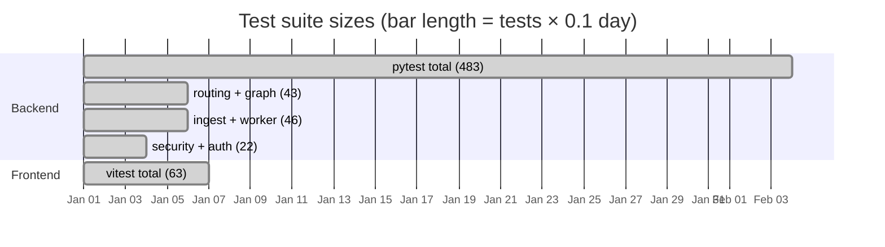

---

## Deployment

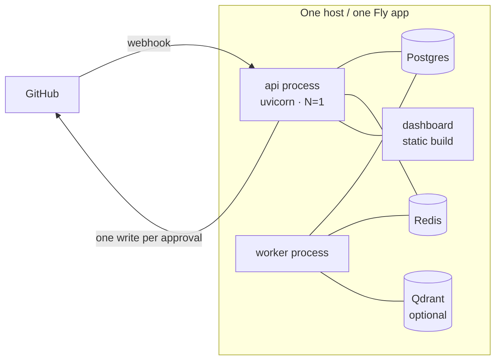

<details>
<summary><b>Fly.io</b></summary>

```bash
fly launch --no-deploy            # uses the committed fly.toml
fly postgres create && fly postgres attach
fly redis create && fly secrets set AUTOPR_REDIS_URL=…
fly secrets set AUTOPR_WEBHOOK_SECRET=… AUTOPR_API_TOKEN=… AUTOPR_GROQ_API_KEY=…
fly deploy                        # release_command runs `alembic upgrade head`
fly scale count worker=1          # worker as its own process group
```
Keep `min_machines_running = 1`; scale-to-zero adds seconds to the first webhook.

</details>

<details>
<summary><b>Docker Compose</b></summary>

```bash
docker compose up --build -d
docker compose logs -f worker
```
The API container waits for Postgres, runs `alembic upgrade head`, then serves. The worker
is a separate service on the same image with a different command.

</details>

<details>
<summary><b>Public demo (strangers may look, nobody may touch)</b></summary>

One flag turns the instance read-only and makes the unsafe versions of it unbootable:

```bash
AUTOPR_PUBLIC_MODE=true
AUTOPR_ALLOWED_REPOS=your-org/your-demo-repo   # required: strangers must not add spend
AUTOPR_GITHUB_DRY_RUN=true                     # required: no writes, ever
AUTOPR_QUOTA_JOBS_PER_REPO_PER_HOUR=10         # required: > 0
AUTOPR_QUOTA_JOBS_TOTAL_PER_DAY=100            # required: > 0
AUTOPR_TRUSTED_PROXIES=127.0.0.1               # your proxy, so per-IP limits are per-visitor
```

What a visitor gets: the dashboard, the real review queue, the code previews, `Copy review`.
What no visitor gets: approve, reject, or a single call to GitHub. The 403 is enforced server-side,
so a hand-written `curl` is refused exactly like the hidden button.

Seed it with synthetic data (`uv run python scripts/seed_demo.py`) rather than pointing it at
repository history you would not publish.

</details>

<details>
<summary><b>Bare metal (systemd)</b></summary>

Two units from the same virtualenv: `uvicorn app.main:app --host 127.0.0.1 --port 8000`
behind nginx, and `python -m app.worker`. Both need the same `AUTOPR_*` environment; only
the API should be reachable from the internet, and only on `/webhook`.

</details>

---

## Troubleshooting

These are the traps this repository actually hit, not hypotheticals.

| Symptom | Cause | Fix |
|---|---|---|
| Webhook returns **503** | Redis is unreachable; ingest fails closed so GitHub retries | Start Redis, or let the worker's reconcile pass pick up the `PENDING` row |
| Webhook returns **401** on a delivery you sent | Signature mismatch — you signed a re-serialised body, not the raw bytes | Sign the exact bytes you send; GitHub always does |
| App won't boot: *"database schema is not migrated"* | `assert_schema_ready()` — Alembic never ran | `uv run alembic upgrade head` |
| App won't boot: *placeholder webhook secret* | Fail-fast validator | Set `AUTOPR_WEBHOOK_SECRET`, or `AUTOPR_ALLOW_INSECURE=1` for local dev |
| App won't boot: *AUTOPR_API_TOKEN is empty* | New fail-fast: an unauthenticated `/approve` is an anonymous approver | Generate a token into `AUTOPR_API_TOKEN`, or `ALLOW_INSECURE=1` locally |
| Webhook returns `{"status":"ignored","reason":"repo_not_allowed"}` | `AUTOPR_ALLOWED_REPOS` is set and does not list that repo | Add the repo, or clear the allowlist to accept all |
| Webhook returns `429 {"detail":"quota exceeded"}` | A cost ceiling tripped (`quota_repo_hourly` / `quota_instance_daily`) — by design, not a bug | Raise the quota, or treat it as the bill guard doing its job |
| Approve returns `403 read-only public demo` | `AUTOPR_PUBLIC_MODE=true` closes writes to everyone, operator included | Unset public mode on the instance that should be able to act |
| Rate limiting does nothing behind a proxy | `X-Forwarded-For` is ignored unless the peer is trusted, so every request shares one bucket | Set `AUTOPR_TRUSTED_PROXIES` to your proxy's IP/CIDR |
| Tests fail only on your machine (15 routing failures) | A `.env` with `AUTOPR_HANDOFF_MODE=true`; the suite now pins its posture before import | Fixed — see `tests/conftest.py`; if you add env-dependent tests, pin them there |
| Approve returns **409** | Another approver holds the claim, or a previous approve crashed mid-post | The startup sweep resets stuck `APPROVED` rows to `FAILED`; approve again |
| Approve returns `already_executed` | Exactly-once working as designed | Nothing to do |
| Job stuck in `processing` forever | A worker died holding it; the row waits for `XAUTOCLAIM` | Wait `AUTOPR_RECLAIM_IDLE_MS` (900 s), or restart the worker |
| Job `DEAD` with `last_error` | 5 executions failed — the cap is intentional | Fix the cause, then create a new delivery (a new SHA) |
| Dashboard shows nothing, no error | A saved token the API rejects | Settings → *Clear token*; tokens are verified against `/stats` before saving |
| Paging/search feels dead | `usePolling` was ignoring request deps (fixed) | It now refetches immediately on change |
| `git push` rejected: *refusing to allow a PAT to create or update workflow* | Token lacks the `workflow` scope | Add the scope, or push workflow changes separately |
| Vite dev server unreachable on `127.0.0.1:5173` | Vite binds IPv6 only | Use `http://localhost:5173` |
| Port 8000 already in use | Something else owns it | `uvicorn --port 8010` and point the Vite proxy at it |
| `ruff format` diffs on Windows only | CRLF vs LF | The repo is LF; `git config core.autocrlf false` |

---

## Roadmap

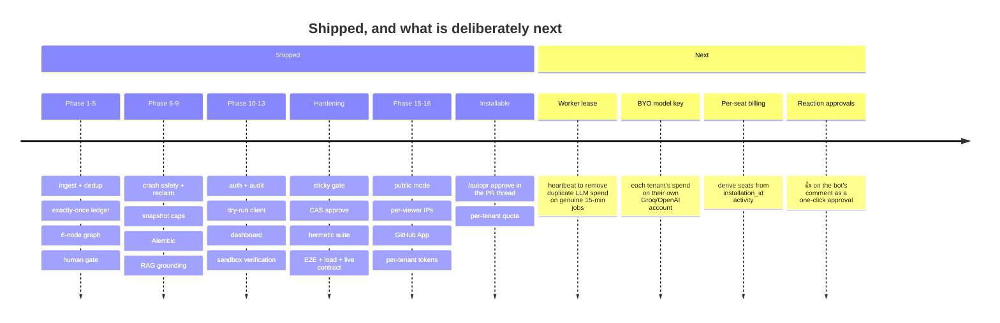

Honest status of the deferred items: **worker lease/heartbeat** is the only known gap in
exactly-once *cost* — with more than one worker, a genuinely >15-minute job can be reclaimed
and charged twice. External side effects stay exactly-once; only model spend duplicates.
**Per-user accounts** remain absent on purpose: tenancy is attributed to an installation and an
approval is attributed to a GitHub login, both verified by GitHub, and there is no AutoPR account
to phish, leak or reset. **BYO model keys** is the next real feature if you want tenants to pay
their own inference bill rather than sharing yours.

---

## Contributing

```bash
uv sync --extra dev
uv run ruff check app tests scripts && uv run ruff format app tests scripts
uv run mypy app
uv run pytest -q                              # 401 tests, ~28 s
cd frontend && npm run lint && npm run typecheck && npm test
python docs/assets/generate.py                # figures must regenerate clean
```

**Ground rules.**

1. **Test or it didn't happen.** A behaviour change lands with a test that fails without it.
   Safety changes land with a test *named after the failure*.
2. **No `any`.** Backend is fully annotated (`mypy` clean); frontend is `strict`.
3. **One-line docstrings** on every function; explain *why*, not *what*.
4. **No new write surface.** If it is not `post_issue_comment`, it needs an ADR in
   `docs/decisions/` first.
5. **The gate is not configurable.** Do not add a flag that auto-applies code changes.
6. **Numbers in the README come from a command.** If you cannot re-run it, do not print it.
   `tests/test_docs_assets.py` enforces this: it re-counts the tree, re-audits every
   figure, re-reads the bench artifact, and fails if the prose has drifted from any of them.
   Any change under `app/`, `tests/`, `frontend/src/`, `scripts/` or `alembic/` therefore
   needs `python docs/assets/generate.py` plus the refreshed composition table — the test
   prints the exact numbers it expects, so the loop is mechanical rather than guesswork.

---

## Regenerating the figures

```bash
python scripts/bench_api.py            # 1. measure → docs/assets/bench_result.json
python docs/assets/generate.py         # 2. draw   → 6 SVGs + svg-audit.json
```

`generate.py` recomputes line counts itself, loads the measured JSON, draws six pure-SVG
figures, then **audits its own layout**: every text element's box must sit inside the canvas
and no two boxes may overlap by more than 2 px. It prints `PASS: 0 issues on 6 figures` or
exits non-zero with the offending labels. Text metrics come from an advance-width model
shared by the layout and the audit, so the check is consistent — it is not a browser
`getBBox()`, and a human should still look at the rendered image.

Latest run: **6 figures, 218 text elements, 0 issues.**

---

## Limitations (read this before deploying)

- **Public *demo* mode is not multi-tenancy.** `AUTOPR_PUBLIC_MODE` has one identity for
everyone: read. There are no accounts and no isolation between visitors — it is your data,
published read-only, which is why it refuses to boot without an allowlist. **GitHub App mode
tier 3** is different: identity is the installation, authority is the collaborator permission
GitHub already grants, and the spend ceiling is per tenant. Don't confuse the two.
- **In App mode, tenant isolation is a `WHERE` clause.** Every tenancy guarantee is a
filter on `installation_id` in a query. There is no row-level security and no per-tenant
database. One missed predicate is a leak of another customer's queue and decisions — this is
the highest-severity bug class in the codebase, and it is a review problem, not a
testing-completeness problem.
- **The App private key is now the crown jewel.** It mints an installation token for every
tenant, so a leak is every customer at once, until the key is rotated. `docs/install.md`
tells you to keep it in the secret store; nothing in the code can verify that you did.
- **The job lease can expire under a genuinely slow job.** `process_job` claims a job with a
conditional `UPDATE`, which prevents two workers from running one job *at the same time*.
If a job runs longer than `AUTOPR_RECLAIM_IDLE_MS` (15 min), a reclaim can run it again:
double LLM spend, never double side effects (the `job_results` ledger is the backstop).
That is the only untested corner of the claim: cross-*process* claiming is now measured on a
real Postgres — 8 processes, one job, one run (`tests/test_worker_multiprocess.py`) — so the
lease window is the remaining assumption, not the claim itself.
- **Measured in-process.** The latency table is `TestClient` + `fakeredis` + SQLite. It is
  reproducible anywhere and pessimistic about nothing; a deployed run adds real network. The
  worker numbers in `scripts/bench_optimisations.py` use a `sleep` for provider latency, so
  they measure scheduling, not a model.
- **The throughput numbers are not a capacity plan.** Concurrency is measured to help
  (2.8–3.1× at 4, capped by SQLite write serialisation); the default of 4 is a memory/rate-limit judgement, not a measured optimum.
  Since phase 18 the claim *has* been run by 8 separate processes against real Postgres; what
  remains unmeasured is a real model provider under load — the worker benchmark still uses a
  `sleep` for provider latency, so it measures scheduling, not inference.
- **LLM agents are mocked in tests.** The suite proves the *plumbing* deterministically; the
  quality of a review is not covered by a test, and cannot be.
- **Prompt injection is unsolved, and now has a per-tenant blast radius.** A malicious diff
  can still make the bot post attacker-chosen *text* as a comment — never code, never a push.
  In App mode the injection arrives on a stranger's PR, so the blast radius is that tenant's
  repo rather than a single operator's.
- **SQLite is the default locally**, which serialises writes, so the hermetic suite proves the
  *logic* rather than Postgres lock behaviour. That distinction is now covered by a separate
  tier: `tests/test_worker_multiprocess.py` runs **8 operating-system processes against a real
  Postgres** racing for one job, and `tests/test_migrations_postgres.py` proves the migration
  cycle on real DDL. Both skip without a server and run in CI against `postgres:16`.
- **RAG is optional and off by default** (`AUTOPR_RAG_ENABLED=false`); with it off the agents
  reason from the diff alone.
- **The sandbox is a defence-in-depth boundary, not a security product.** Non-root,
  `--network none`, read-only rootfs and resource caps, but it has not been adversarially
  reviewed to run untrusted third-party code at multi-tenant scale.
- **No real installation has been run by the author**, because registering a GitHub App needs a
  browser session this project cannot supply. What exists instead is
  `scripts/verify_installation.py`: one command that runs the whole chain against real
  credentials — private key parses → JWT verifies → `GET /app` → installation token minted →
  repos visible → permission lookup → optional comment — and prints PASS/FAIL per step. Its own
  16 tests pin every failure mode (wrong token prefix, expired token, repo outside the
  installation, rejected JWT), and `github-live.yml` runs it weekly the moment App secrets are
  configured. Until that happens, treat App mode as *built and unit-proven, not yet lived-in*.

  What *has* now been exercised by GitHub itself is the delivery leg. A repository webhook was
  created, a public tunnel pointed at a running instance, and the deliveries were judged from
  **GitHub's own delivery log**: a correctly-signed `ping` → `200` (0.79 ms), the same `ping`
  with a deliberately wrong secret → **`401`**, rejected with `webhook.invalid_signature` in our
  log, and a real `pull_request` delivery (PR #1) → `200` (1.71 ms), ingested as
  `job_id=1 … sha=e07f22c6` with `XLEN autopr:jobs` = 1. A first attempt got `503` because
  Redis was down: the endpoint failed closed rather than accept work it could not queue. That
  proves signature verification and ingestion against real signed traffic — it does **not** prove
  registration or installation-token minting, because a repository webhook carries no
  `installation` object. App registration has no REST endpoint; it is browser-only, which is why
  `scripts/verify_installation.py` exists instead of a claim that it was done.

---

## License

[MIT](LICENSE) © 2026 Sheikh Ayaan

<p align="center">
<a href="https://star-history.com/#sheikhayaan/AUTOPR&Date">

</a>
</p>

<p align="center"><sub>Every figure in this document is generated by <code>docs/assets/generate.py</code> from <code>docs/assets/bench_result.json</code> and from line counts taken at build time — see <a href="#regenerating-the-figures">Regenerating the figures</a>.</sub></p>
