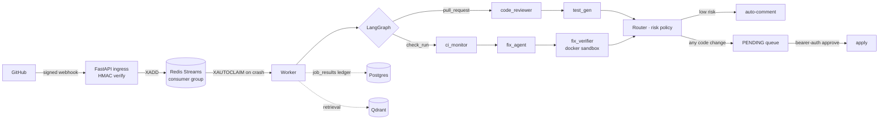

# AutoPR

**A pull-request reviewer and CI repairer that is not allowed to write unsupervised.**

AutoPR listens to GitHub webhooks, reviews diffs and failing checks with a LangGraph
agent graph, and proposes fixes. Every proposal that changes code is parked as
`PENDING` until a human approves it through an authenticated API call. Low-risk
findings may post a *comment* on their own — that is the entire autonomy budget.

`Python 3.11` · `FastAPI` · `LangGraph` · `Redis Streams` · `Postgres` · `Qdrant` · `Docker` · MIT

> No hosted demo. The service is only useful with a real GitHub token and write
> credentials, and shipping those to a public URL is not a thing to do.

---

## Why this exists

The interesting part of an LLM pipeline is not the prompts. It is everything
around a model that is slow, non-deterministic, and occasionally wrong, because
that is what decides whether the thing is safe to point at a real repository.

AutoPR is built around one rule: **risk lowers autonomy, never raises it.** The
router can demote a change from "auto-post a comment" to "ask a human", and it can
never do the reverse.

## What it does

| Surface | Behaviour |
| :-- | :-- |
| `pull_request` | `code_reviewer` reads the diff, `test_gen` proposes tests for the changed code, the router scores the outcome |
| `check_run` (failed) | `ci_monitor` reads the failure, `fix_agent` proposes a patch, `fix_verifier` replays the patch and re-runs the check |
| Comment | Auto-posted only at `≤ low` risk, and dry-run is the default |
| Code change | Always `PENDING`; applied only by `POST /reviews/{id}/approve` with a bearer token |
| Dashboard | Read-only view of the queue, jobs, and decisions — the same ledger the worker writes |

## Architecture



### Request lifecycle

1. **Ingress does no model work.** The raw body is HMAC-verified in constant time
   before anything is parsed. The job row is persisted idempotently, the event is
   `XADD`ed, and the request returns `200` immediately.
2. **The queue is a Redis Stream, not `BackgroundTasks`.** A consumer group with
   `XAUTOCLAIM` reclaims a dead worker's un-acked entries, and a startup reconcile
   re-enqueues rows still marked `PENDING`.
3. **Exactly-once-ish.** A `job_results` ledger keyed by `job_id`
   (`INSERT … ON CONFLICT DO NOTHING`) turns at-least-once delivery into
   effectively-once processing.
4. **Two agent tracks, one router.** `code_reviewer → test_gen` for pull requests,
   `ci_monitor → fix_agent → fix_verifier` for failing checks.
5. **The sandbox is disposable.** `fix_verifier` applies the proposal to a snapshot
   inside Docker with `--network none`, dropped capabilities and resource caps, then
   re-runs the failing check before a human ever sees the patch.
6. **Failure is bounded.** Attempts increment per job; past `AUTOPR_MAX_ATTEMPTS`
   the job is parked `DEAD` with its last error instead of retried forever.

## Design decisions

Each of these has an ADR under [`docs/decisions/`](docs/decisions) — thirteen in
total, written when the decision was made, not after.

1. **Streams over a task queue.** `BackgroundTasks` loses work on restart and has no
   acknowledgement model. A consumer group plus a `job_results` ledger buys
   redelivery, reclaim, and an audit trail for the price of one Redis instance.
2. **Risk can only reduce autonomy.** A scoring function is a heuristic, and
   heuristics are wrong in both directions. Wiring it so its only power is to
   *withhold* action means a bad score degrades to "ask a human", never to "ship it".
3. **Unparseable risk fails closed.** If the router cannot read the model's risk
   output, the outcome goes to the human queue. A parse error is not evidence of safety.
4. **Verify, then show.** The patch a human approves is the patch that already
   compiled and passed the failing check in the sandbox — not a proposal that merely
   reads well.
5. **Boot-time refusal over silent insecurity.** The app will not start on the
   shipped placeholder webhook secret unless `AUTOPR_ALLOW_INSECURE=1`, and an empty
   API token logs a loud warning because it turns off the only write gate.
6. **The dashboard reads the ledger.** No separate UI state to drift out of sync with
   what the worker actually did.

## Quick start

**Prerequisites:** Python 3.11 via [uv](https://docs.astral.sh/uv/), Node 20+. Docker
Desktop only for the Compose stack or the CI-fix sandbox.

```bash
# 1. backend, native, SQLite, zero infra
uv sync --extra dev
AUTOPR_ALLOW_INSECURE=1 AUTOPR_LOG_JSON=false \
  uv run uvicorn app.main:app --reload --port 8000
# http://localhost:8000/docs

# 2. optional demo data (~10 jobs + a populated review queue); safe to re-run
uv run python scripts/seed_demo.py

# 3. dashboard
cd frontend && npm ci && npm run dev     # http://localhost:5173, proxies /api → :8000

# 4. or the whole stack: Postgres, Redis, Qdrant, API, worker
cp .env.example .env                     # set AUTOPR_WEBHOOK_SECRET + AUTOPR_API_TOKEN
docker compose up --build
```

With Redis absent the API logs `startup.queue_unavailable` and the webhook returns
`503`: that is the designed degradation, and the read APIs keep working.

Configuration is documented inline in [`.env.example`](.env.example). The two values
that matter are the webhook secret (HMAC) and `AUTOPR_API_TOKEN` (the write gate).

## Tests

```bash
uv run pytest            # backend: ingest, policy, store, sandbox, graph
cd frontend && npm test  # vitest: api client, error boundary
```

CI runs both on every push (`.github/workflows/ci.yml`), plus a lint/format gate.

## Limits

- **Never pointed at a repository with real traffic.** Retry, dead-letter and approval
  paths are exercised by tests and by a sandbox that only ever sees synthetic patches.
- **Single-container sandbox.** One patch at a time per job; no isolation between
  concurrent verifications beyond Docker's own.
- **No summarisation agent.** The graph is `code_reviewer`, `test_gen`, `ci_monitor`,
  `fix_agent`, `fix_verifier`, `router` — nothing else. Long histories are truncated
  by the agent layer rather than compressed by a dedicated one.

## Docs

- [`docs/architecture.md`](docs/architecture.md) — component map and data flow
- [`docs/decisions/`](docs/decisions) — thirteen ADRs, one per phase
- [`docs/api.md`](docs/api.md) — endpoints and auth
- [`docs/operations.md`](docs/operations.md) — deploy, backup, troubleshooting

## Author

**Mohd Ayaan** — [github.com/sheikhayaan](https://github.com/sheikhayaan) ·
[LinkedIn](https://linkedin.com/in/mohd-ayaan-7731b4381)

MIT licensed. See [LICENSE](LICENSE).
