# AutoPR

**A multi-agent system that reviews pull requests and repairs failing CI — safely.**

AutoPR watches a repository's GitHub webhooks and, for every pull request or
failed check, runs a LangGraph agent pipeline that reviews the diff, drafts
tests, or proposes a fix. Anything that would change code, or carries more than
trivial risk, is **never applied automatically** — it is queued for a human to
approve on a dashboard. The system's job is to do the reading, reasoning, and
drafting; the maintainer keeps the final say.


<!-- Live CI badge once pushed:
[](https://github.com/sheikhayaan/AUTOPR/actions/workflows/ci.yml)
-->

---

## Table of contents

- [Why this exists](#why-this-exists-the-one-paragraph-pitch)
- [System at a glance](#system-at-a-glance)
- [The gate, as a decision tree](#the-gate-as-a-decision-tree)
- [Two agent tracks](#two-agent-tracks)
- [Lifecycles (state machines)](#lifecycles-state-machines)
- [One approval, end to end](#one-approval-end-to-end)
- [Data model](#data-model)
- [Safety invariants](#safety-invariants-the-part-that-matters)
- [Engineering highlights](#engineering-highlights)
- [Quality: what the numbers actually are](#quality-what-the-numbers-actually-are)
- [Quick start](#quick-start)
- [Tests](#tests)
- [Configuration](#configuration)
- [Project layout](#project-layout)
- [Documentation](#documentation)

---

## Why this exists (the one-paragraph pitch)

Reviewing PRs and babysitting flaky CI is exactly the kind of high-volume,
pattern-heavy work an LLM is good at — and exactly the kind of work you must
**not** let an LLM do unsupervised, because the blast radius of a wrong automated
commit is unbounded. AutoPR is built around that tension. The interesting
engineering isn't the prompts; it's everything that makes an unreliable, slow,
non-deterministic model safe to put in front of a real repository: **exactly-once
job processing**, a **crash-safe queue**, a **dry-run write boundary**, and a
**human-in-the-loop approval gate** that no agent can bypass.

It is deliberately right-sized for a **single-operator, 1–50-request** workload:
one uvicorn process, SQLite-with-WAL by default (Postgres in Compose/cloud), and
a single Redis stream. The correctness and safety machinery is production-grade;
the horizontal-scale machinery is intentionally *not* built, and every such
trade-off is written down in [`docs/decisions/`](docs/decisions/).

---

## System at a glance

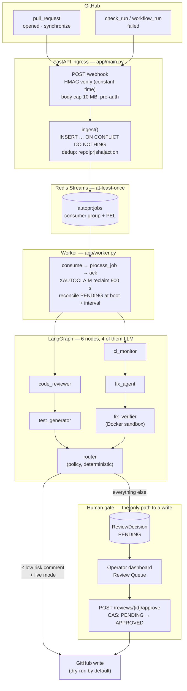

### Runtime topology

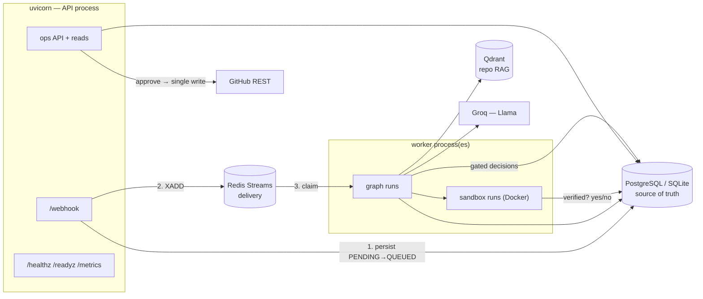

Redis is *delivery*, Postgres is *truth*. That split is why the webhook can
return `200` in milliseconds and why a Redis wipe loses no work: the worker's
reconcile pass re-publishes every `PENDING` row.

---

## The gate, as a decision tree

This is the whole product in one chart. Everything else is plumbing.

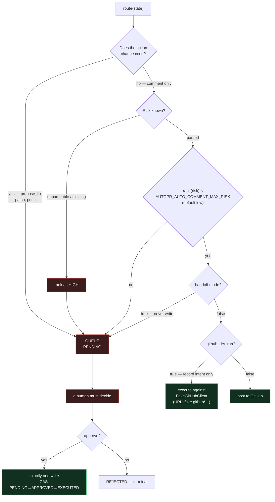

**Read the tree bottom-up:** there is no path from model output to a mutated
repository that does not pass through a human click.

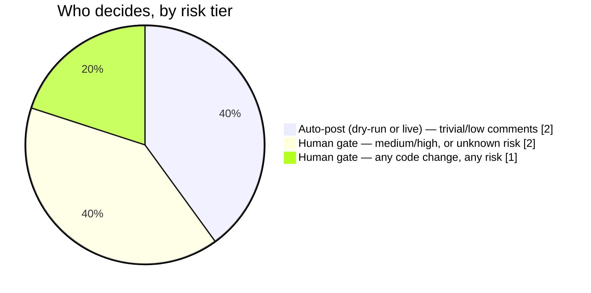

---

## Two agent tracks

### Track A — PR review (`pull_request`)

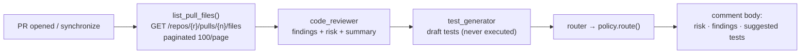

### Track B — CI repair (`check_run` / `workflow_run`)

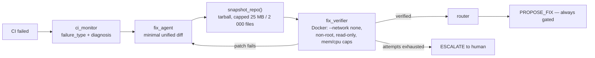

The sandbox is the point: a fix is only ever *proposed* after a container has
actually re-run the failing check against a real snapshot of the repository. But
even a verified fix is human-gated — a green sandbox is evidence, not permission.

---

## Lifecycles (state machines)

### Job (`PRJob.status`)

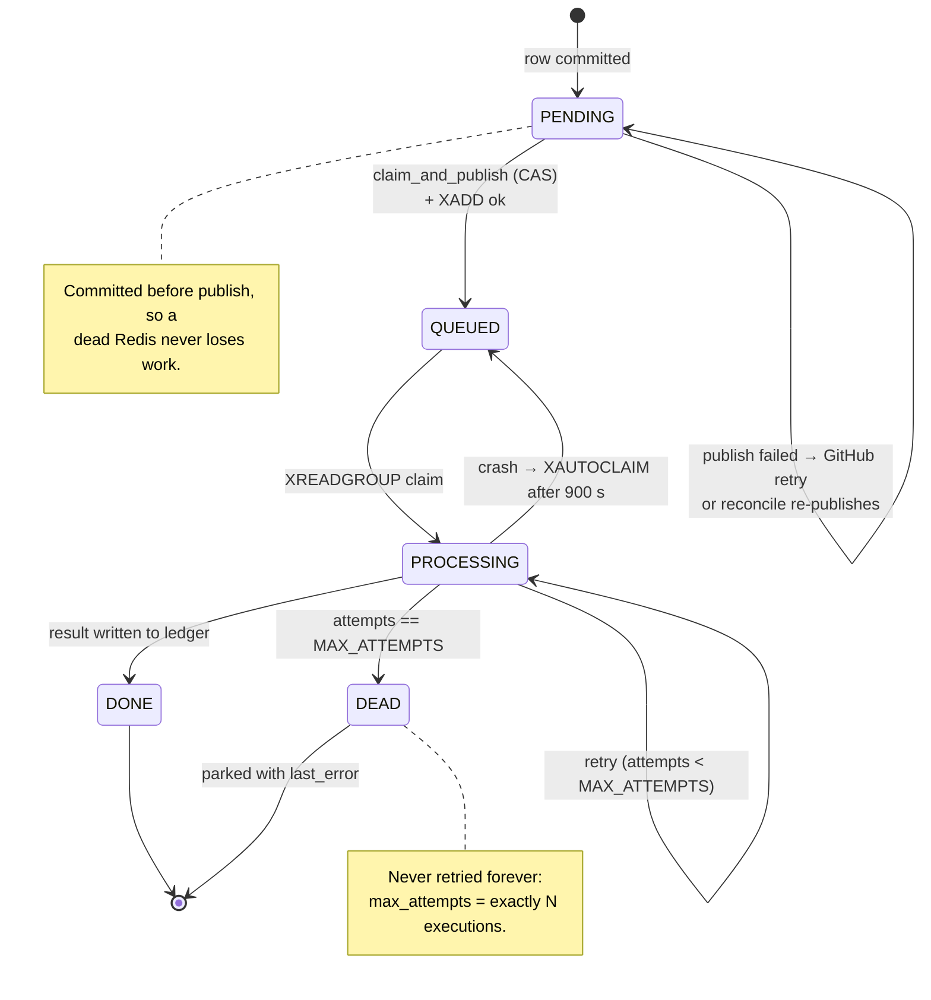

### Decision (`ReviewDecision.status`)

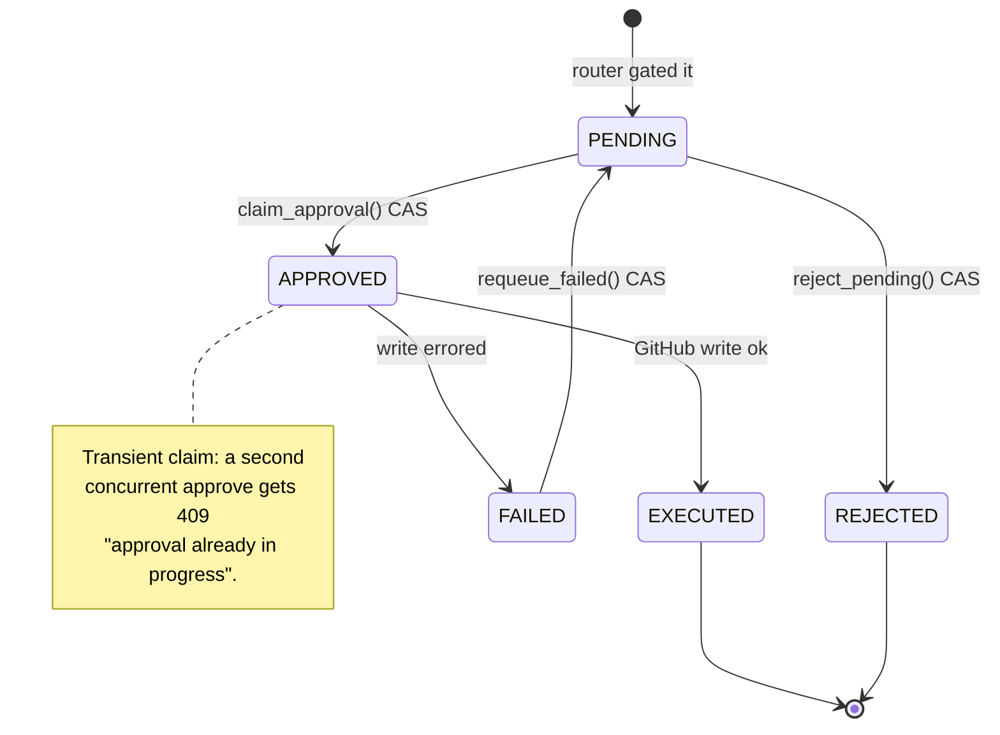

`mark_approved` no longer exists as a free function — approval is only ever a
compare-and-set, which is what makes a double-click unable to post twice.

---

## One approval, end to end

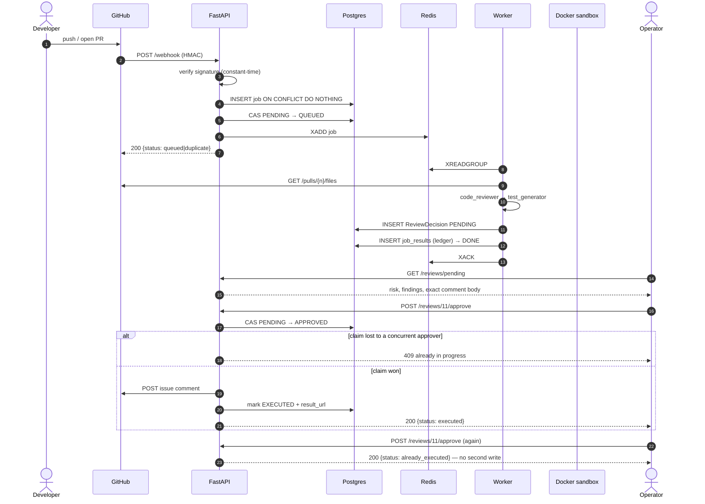

---

## Data model

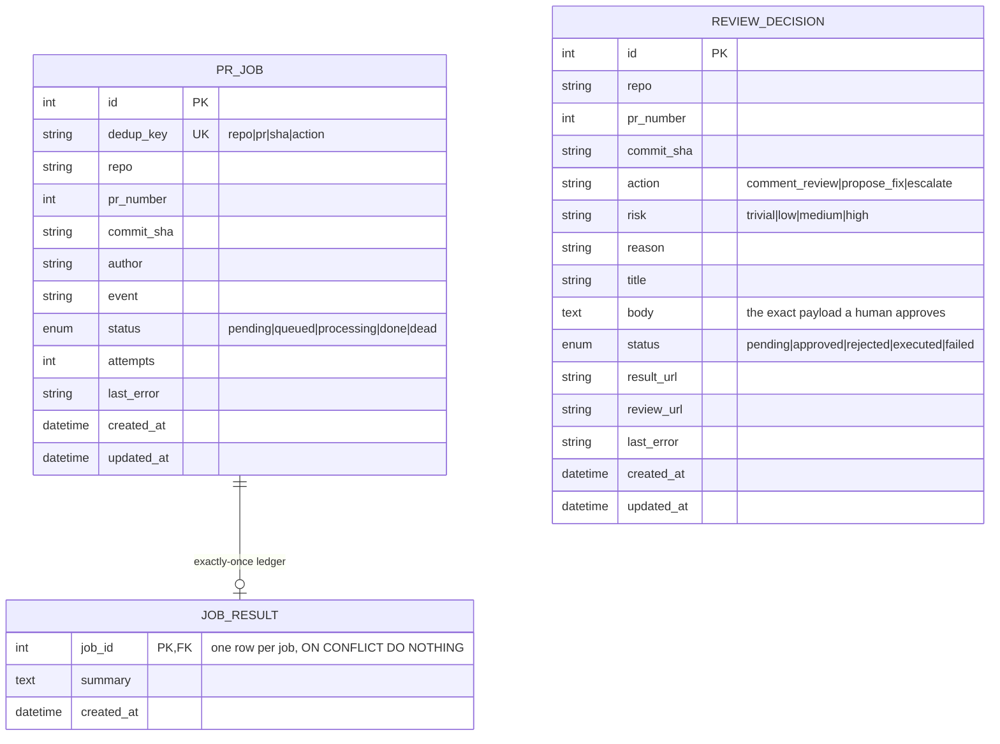

`JobResult` is the idempotency primitive: `job_id` is its primary key, so a
redelivered job's second attempt is a row-level no-op rather than a second post.

---

## Safety invariants (the part that matters)

These hold regardless of configuration, risk score, or model output:

1. **Dry-run by default.** `AUTOPR_GITHUB_DRY_RUN=true` out of the box. The GitHub
   client records the action it *would* take and touches nothing. You must
   deliberately opt into live posting.
2. **Every code-changing action is human-gated.** A proposed fix — even one the
   sandbox verified as passing — is written to the approval queue as `PENDING`
   and applied only when a human approves. No agent, no risk score, and no config
   flag can auto-apply code.
3. **Only ≤ low-risk *comments* auto-post.** The ceiling is
   `AUTOPR_AUTO_COMMENT_MAX_RISK` (default `low`). Unknown/unparseable risk ranks
   as high and fails closed to the human queue.
4. **The webhook is authenticated.** Every delivery is HMAC-verified against
   `AUTOPR_WEBHOOK_SECRET` in constant time — and the body cap is enforced
   *before* the HMAC, so an attacker cannot make you hash a 4 GB payload. The app
   **refuses to start** on the shipped placeholder secret unless
   `AUTOPR_ALLOW_INSECURE=1` (local/dev/tests).
5. **The write API is authenticated.** `approve`/`reject` require a bearer token
   (constant-time compared) whenever `AUTOPR_API_TOKEN` is set, and every approval
   emits an `audit.*` log line (actor IP, decision, action, outcome).
6. **The gate is sticky.** Once a decision exists for `repo|pr|sha|action`, a
   later delivery cannot re-drive it: `PENDING`/`APPROVED`/`REJECTED`/`EXECUTED`
   are terminal for the auto path, and only `FAILED` is retryable. This is a
   fixed bug, with a regression test named after the bypass.
7. **Secrets never enter the image or the repo.** `.env` is gitignored; Compose
   and Fly inject secrets at runtime. The Groq API key lives only in `.env`.

---

## Engineering highlights

| Concern | How AutoPR handles it |
| --- | --- |
| **Exactly-once processing** | A `job_results` ledger keyed by `job_id` with `INSERT … ON CONFLICT DO NOTHING` (Postgres *and* SQLite). At-least-once delivery + an idempotent write = effectively-once. |
| **Exactly-once approvals** | `claim_approval()` is a conditional `UPDATE` (`PENDING → APPROVED`). The loser of a race gets `409 approval already in progress`; a later call gets `already_executed`. |
| **Crash safety** | Redis Streams consumer group; a dead worker's un-acked entries are reclaimed via `XAUTOCLAIM`; `PENDING` rows (committed but never published) are re-published at worker startup, every `AUTOPR_RECONCILE_INTERVAL_S`, and immediately when a GitHub retry lands on the dedup key. Publication itself is a compare-and-set, so a repair cannot double-enqueue. |
| **Bounded failure** | `attempts` counts *executions*: `AUTOPR_MAX_ATTEMPTS` runs, then the job is parked `DEAD` with its last error, never retried forever. |
| **Bounded memory** | Repo snapshots are capped per file (1 MB), per count (2 000), in total (25 MB), and mid-stream on the tarball (100 MB) — an outsized repo aborts *while arriving*, not after being buffered. |
| **Graceful degradation** | Redis down → the webhook fails closed with **503** (GitHub retries), while the read-only dashboard keeps serving from the database. `/readyz` reports the truth. |
| **Schema migrations** | Alembic only — `create_all` is gone, and `assert_schema_ready()` refuses to boot with an actionable message if models and migrations drift. CI drives a real-Postgres up → down → up round-trip, plus a metadata-drift test. |
| **Observability** | structlog JSON from both processes; a `correlation_id` that rides contextvars in-process and the job payload across the queue; `/healthz` (liveness) vs `/readyz` (deep) vs `/metrics` (Prometheus). |
| **Security perimeter** | Fail-fast secret validation, constant-time HMAC + bearer checks, pre-auth body cap, per-IP rate limiting, a CORS allowlist, and audit logging on every write. |
| **Typed end-to-end** | The React dashboard is TypeScript; its response models mirror the API serializers, so a field rename on either side is a compile error, not a runtime `undefined`. |

---

## Quality: what the numbers actually are

Measured on this commit, no overrides:

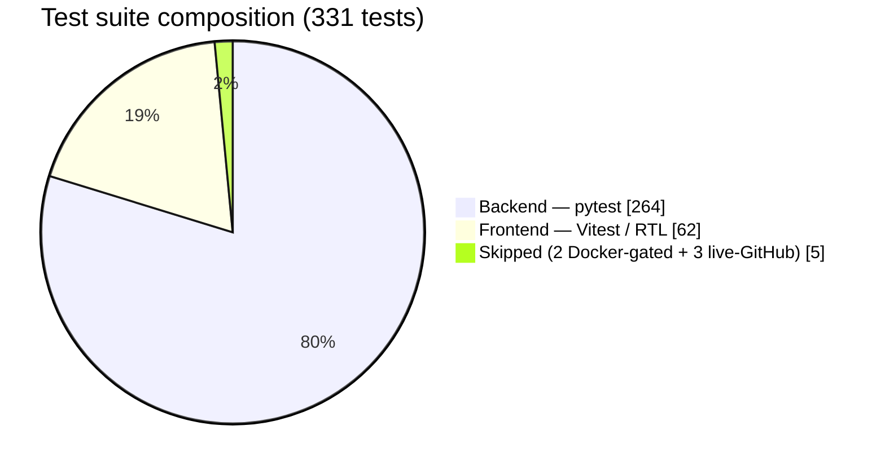

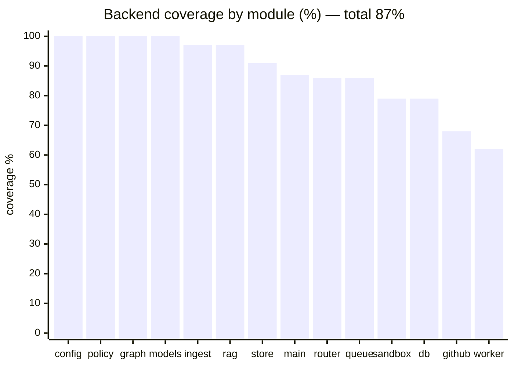

| Gate | Result |
| --- | --- |
| `pytest` | **264 passed, 5 skipped** — green with a hostile `.env` (`AUTOPR_HANDOFF_MODE=true`) |
| coverage `--cov=app` | **87%** (gate: 78%) |
| `ruff check` + `ruff format --check` | clean, 64 files |
| `mypy app` | clean, 30 source files |
| `vitest` | **62 passed** across 9 files |
| `prettier` + `tsc -b` + `eslint --max-warnings 0` | clean |

The 5 skips are deliberate: 2 need Docker + the sandbox image (they run in the
dedicated CI job, which **fails if they skip**), and 3 need a real GitHub token.

### The shortest possible proof

`tests/test_e2e_flow.py` crosses every seam in one test: signed webhook → worker
→ graph → gate → `/reviews/pending` → approve → exactly one comment → **approve
again returns `already_executed`** → history. No mocks at the seams; only the
LLM and the sandbox are faked.

---

## Quick start

**Prerequisites:** Python 3.11 (via [uv](https://docs.astral.sh/uv/)), Node 20+.
Docker Desktop only if you want the full Compose stack or the CI-fix sandbox.

### 1. Run the backend (native, SQLite — zero infra)

```bash
# from the repo root
uv sync --extra dev                     # create .venv from the committed uv.lock

# SQLite + no external services; allow the dev placeholder secret
AUTOPR_ALLOW_INSECURE=1 AUTOPR_LOG_JSON=false \
  uv run uvicorn app.main:app --reload --port 8000
```

The API is now at `http://localhost:8000` (interactive docs at `/docs`). With no
Redis running it logs `startup.queue_unavailable` and the webhook returns 503 —
that's the designed degradation; the dashboard's read APIs work regardless.

Schema: run `uv run alembic upgrade head` first — the app will tell you so if the
tables are missing rather than crashing on `no such table`.

### 2. Seed realistic demo data (optional but recommended)

```bash
uv run python scripts/seed_demo.py      # ~10 jobs + a populated review queue
```

Safe to re-run — it owns only the `acme/*` demo rows and leaves real data alone.

### 3. Run the dashboard

```bash
cd frontend
npm ci
npm run dev                             # http://localhost:5173
```

The dev server proxies `/api/*` to the backend on `:8000`, so the browser stays
same-origin. Open **http://localhost:5173** — Overview, Review Queue, Jobs and
History should all light up with the seeded data. If `AUTOPR_API_TOKEN` is set,
paste it into **Settings** (it is verified against `GET /stats` before it is
saved).

### 4. (Alternative) The whole stack in Docker

```bash
cp .env.example .env
# set AUTOPR_WEBHOOK_SECRET and AUTOPR_API_TOKEN (both required by Compose):
#   python -c "import secrets; print(secrets.token_hex(32))"
docker compose up --build
```

Brings up Postgres, Redis, Qdrant, the API (which runs `alembic upgrade head`
first), and the worker. See [`docs/operations.md`](docs/operations.md).

### 5. Connect a real repository

GitHub → your repo (or the whole org) → **Settings → Webhooks → Add webhook**:

| Field | Value |
| --- | --- |
| Payload URL | `https://<your-host>/webhook` |
| Content type | `application/json` |
| Secret | your `AUTOPR_WEBHOOK_SECRET` |
| Events | *Pull requests*, *Check runs*, *Workflow runs* |

There is no login, no app install, and no OAuth: a signed webhook is the entire
integration. Leave `AUTOPR_GITHUB_DRY_RUN=true` for the first week and read what
it *would* have posted in the dashboard before letting it comment for real.

---

## Tests

The backend suite is **hermetic** — in-memory SQLite, `fakeredis`, and a mocked
LLM — so it runs fully offline and fast. It also pins its own safety posture
(`AUTOPR_HANDOFF_MODE=false`, no API token, rate limiting off, dry-run on) in
`tests/conftest.py`, so a developer's local `.env` cannot change what the tests
assert; tests that need the opposite posture opt in explicitly.

```bash
uv run pytest -q                                    # all backend tests
uv run pytest --cov=app --cov-report=term-missing   # with coverage
```

```bash
cd frontend && npm test                             # Vitest + React Testing Library
```

Three suites are opt-in because they need the outside world:

| Suite | Needs | Run it with |
|---|---|---|
| `tests/test_sandbox_docker.py` | Docker + `autopr-sandbox:latest` | `docker build -f docker/sandbox.Dockerfile -t autopr-sandbox:latest . && uv run pytest tests/test_sandbox_docker.py` |
| `tests/test_github_live.py` | a real token + repo (read-only) | `AUTOPR_LIVE_GITHUB_TOKEN=… AUTOPR_LIVE_GITHUB_REPO=o/r AUTOPR_LIVE_GITHUB_PR=1 uv run pytest tests/test_github_live.py` |
| `tests/test_e2e_flow.py` | nothing | `uv run pytest tests/test_e2e_flow.py` |

`scripts/load_test.py` measures the ingest path against a running deployment and
exits non-zero if p95 latency or the 5xx budget is blown:

```bash
uv run python scripts/load_test.py --url http://localhost:8000 --secret "$AUTOPR_WEBHOOK_SECRET" --rps 20 --duration 15
```

CI (`.github/workflows/ci.yml`) runs ruff, mypy, pytest with a coverage gate, a
real-Postgres Alembic round-trip, the Docker-gated sandbox boundary tests, the
frontend lint/type/test/build, and a build of both container images.
`.github/workflows/live.yml` runs the live GitHub contract test on demand and
weekly (read-only, skipped when the secret is absent).

---

## Configuration

Every setting is an `AUTOPR_`-prefixed environment variable (see
[`.env.example`](.env.example) and [`app/config.py`](app/config.py)). The ones
you're most likely to touch:

| Variable | Default | Purpose |
| --- | --- | --- |
| `AUTOPR_WEBHOOK_SECRET` | *(placeholder)* | HMAC secret for GitHub deliveries. App refuses to start on the placeholder unless `AUTOPR_ALLOW_INSECURE=1`. |
| `AUTOPR_API_TOKEN` | *(empty)* | Bearer token for `approve`/`reject`. Empty = unauthenticated dev no-op (with a loud warning). |
| `AUTOPR_DATABASE_URL` | `sqlite+pysqlite:///./autopr.db` | SQLite locally; a `postgresql+psycopg://…` URL in Compose/cloud. |
| `AUTOPR_REDIS_URL` | `redis://localhost:6379/0` | Queue backend. |
| `AUTOPR_GITHUB_DRY_RUN` | `true` | Master safety switch. `true` = touch nothing. |
| `AUTOPR_GITHUB_TOKEN` | *(empty)* | Enables live GitHub reads/writes. Only meaningful with dry-run off. |
| `AUTOPR_AUTO_COMMENT_MAX_RISK` | `low` | Ceiling for *auto-posting comments*. Code changes are never covered by this. |
| `AUTOPR_HANDOFF_MODE` | `false` | `true` = never write at all; approvals just hand you a PR link. |
| `AUTOPR_MAX_ATTEMPTS` | `5` | Exactly this many executions, then `DEAD`. |
| `AUTOPR_RECLAIM_IDLE_MS` | `900000` | Idle window before another worker may XAUTOCLAIM. Warns below 5 min. |
| `AUTOPR_MAX_WEBHOOK_BYTES` | `10000000` | Body cap, enforced while streaming and *before* HMAC. |
| `AUTOPR_GROQ_API_KEY` | *(empty)* | Powers the LLM agents (Llama via Groq). Kept only in `.env`. |
| `AUTOPR_QDRANT_URL` | *(empty)* | Enables repo-grounded retrieval; unset = retrieval disabled. |
| `AUTOPR_CORS_ORIGINS` | local dev origins | Comma-separated allowlist for the dashboard origin. |

---

## Project layout

```mermaid
flowchart TD
    ROOT["AUTOPR/"]

    ROOT --> APP["app/"]
    ROOT --> ALEMBIC["alembic/"]
    ROOT --> FRONT["frontend/"]
    ROOT --> TESTS["tests/"]
    ROOT --> SCRIPTS["scripts/"]
    ROOT --> DOCS["docs/"]
    ROOT --> OPS["Dockerfile · docker-compose.yml<br/>fly.toml · docker/sandbox.Dockerfile"]

    APP --> A1["main.py — webhook + ops API + reads"]
    APP --> A2["worker.py — consume · reclaim · reconcile"]
    APP --> A3["ingest.py — idempotent persist + enqueue"]
    APP --> A4["queue.py — Streams, PEL, XAUTOCLAIM"]
    APP --> A5["models.py — PRJob · JobResult · ReviewDecision"]
    APP --> A6["db.py · config.py · security.py<br/>ratelimit.py · observability.py"]
    APP --> AG["agents/ — graph.py + code_reviewer · test_generator<br/>ci_monitor · fix_agent · fix_verifier · router · rag"]
    APP --> AR["routing/ — policy.py · store.py · github.py<br/>(dry-run client, reader)"]
    APP --> AS["sandbox/ — runner.py · verifier.py · policy.py"]

    FRONT --> F1["pages/ — Overview · ReviewQueue · Jobs · History"]
    FRONT --> F2["components/ — Layout · StatCard · SettingsDialog"]
    FRONT --> F3["api/client.ts — typed, token-aware"]

    TESTS --> T1["hermetic: SQLite + fakeredis + mocked LLM"]
    TESTS --> T2["test_e2e_flow.py — full-stack, no seam mocks"]
    DOCS --> D1["architecture · operations · api"]
    DOCS --> D2["decisions/ — 13 phase ADRs"]
```

### Domain vocabulary

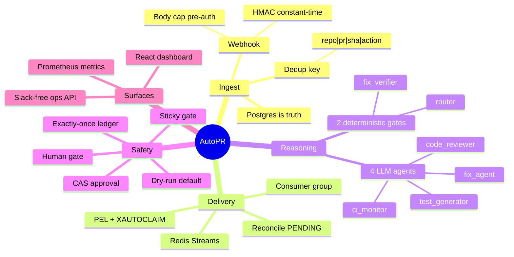

---

## Documentation

- **[Architecture](docs/architecture.md)** — components, data flow, both tracks, the exactly-once and human-gating mechanics.
- **[Operations runbook](docs/operations.md)** — deploy, scale workers, rotate secrets, migrate, observe, and what degrades when a dependency dies.
- **[API reference](docs/api.md)** — every endpoint, auth, and `curl` examples.
- **[Decision logs](docs/decisions/)** — one ADR per phase: the choice made, the alternative rejected, and the corners deliberately cut.

### Endpoint map

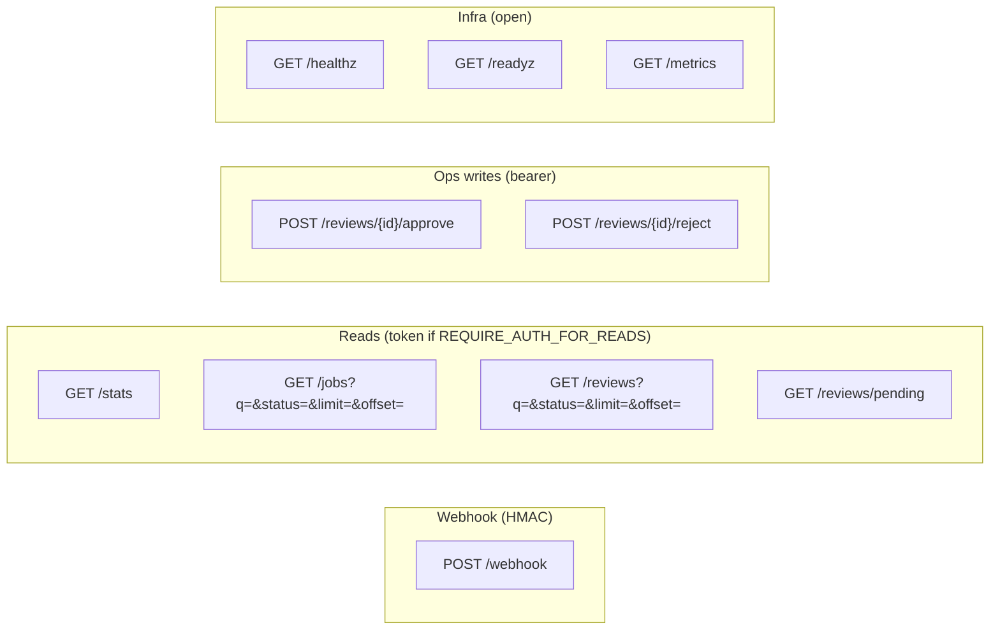

---

## License

[MIT](LICENSE).
