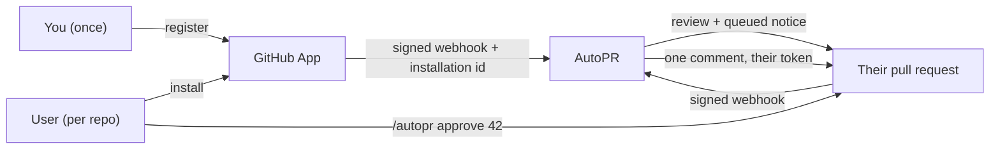

# Install AutoPR

Two people are involved, and they never talk to each other:

- **You, the operator** — deploy the service once, register one GitHub App, keep two secrets.
- **Your users** — click *Install*, pick repos, open a pull request. That is the entire signup.

No accounts, no passwords, no tokens to hand out. A user's identity is their GitHub installation;
their authority is the permission GitHub already says they have on the repo.



---

## 0. What you need before starting

| Requirement | Why |
|---|---|
| A host with a **public HTTPS URL** | GitHub must reach `POST /webhook` |
| Docker + Docker Compose | the worker executes proposed patches in a sandbox |
| A **Groq API key** (or a compatible LLM endpoint) | the review itself |
| Redis + Postgres | queue and source of truth (Compose provides both) |
| ~15 minutes | most of it is GitHub's App form |

You do **not** need a GitHub personal access token for multi-tenant mode. In App mode there is
deliberately no instance-wide repository credential — every write uses a per-installation token.

---

## 1. Deploy the service

```bash
git clone https://github.com/sheikhayaan/AUTOPR && cd AUTOPR
cp .env.example .env
```

Generate the two secrets you cannot invent later:

```bash
# 64 hex chars each
python -c "import secrets; print(secrets.token_hex(32))"   # AUTOPR_WEBHOOK_SECRET
python -c "import secrets; print(secrets.token_hex(32))"   # AUTOPR_API_TOKEN
```

In `.env`, the values that matter:

```bash
AUTOPR_WEBHOOK_SECRET=<the hex you just generated>
AUTOPR_API_TOKEN=<the other hex>
AUTOPR_GROQ_API_KEY=<your key>
AUTOPR_GITHUB_DRY_RUN=true          # keep true until step 5
```

Then:

```bash
docker compose up -d --build
docker compose ps          # api and worker both "healthy"
```

Two processes are required and both need the same secrets: `api` receives webhooks, `worker` runs
the agents and posts the comments. A worker without the App credentials queues work and then
finds itself unable to speak for the tenant — the Compose file passes them to both on purpose.

---

## 2. Register the GitHub App

Go to **Settings → Developer settings → GitHub Apps → New GitHub App**
(<https://github.com/settings/apps/new>).

### The form

| Field | Value |
|---|---|
| **GitHub App name** | anything unique, e.g. `myorg-autopr` |
| **Homepage URL** | your host, e.g. `https://autopr.example.com` |
| **Webhook** → Active | ✅ **checked** |
| **Webhook URL** | `https://your-host/webhook` |
| **Webhook secret** | the same value as `AUTOPR_WEBHOOK_SECRET` |
| **Where can this be installed?** | *Any account* — this is what makes it self-serve |
| **Request user authorization (OAuth)** | ❌ leave off — AutoPR never signs anyone in |
| **Redirect URL** | leave empty |

### Repository permissions — exactly three

| Permission | Level | The call that requires it |
|---|---|---|
| **Contents** | Read | `GET /repos/{r}/tarball/{ref}` — snapshot the tree so the sandbox can prove a patch |
| **Pull requests** | Read | `GET /repos/{r}/pulls/{n}/files` — read the diff under review |
| **Issues** | Write | `POST /repos/{r}/issues/{n}/comments` — the **only** write in the product |

*Metadata: Read* is granted implicitly by GitHub and is not a choice.

**Do not grant Checks.** CI failure logs arrive inside the `check_run` / `workflow_run` payload;
the API is never asked for them. Every permission above is derived from a real call site, so if
this list and the code ever disagree, the code is right.

There is no *Contents: write*, no *Administration*, and no *Workflows* — AutoPR **cannot** push,
merge, open a branch, or edit a workflow, by construction. It posts one comment.

### Subscribe to events

Check exactly these six:

| Event | What it is for |
|---|---|
| `pull_request` | the review — opened, synchronised, reopened |
| `check_run` | CI failure, with logs inline |
| `workflow_run` | CI failure from Actions, with logs inline |
| `issue_comment` | `/autopr approve 42` — the approval channel |
| `installation` | created / suspend / unsuspend / deleted |
| `installation_repositories` | a tenant adding or removing repos |

### Key

After creating the App: **Private keys → Generate a private key**. A `.pem` downloads exactly
once. GitHub will never show it again.

Note the **App ID** at the top of the App's page, and the **slug** in its public URL
(`github.com/apps/<slug>`).

---

## 3. Configure the credentials

```bash
AUTOPR_GITHUB_APP_ID=123456
AUTOPR_GITHUB_APP_PRIVATE_KEY="$(cat ~/Downloads/myorg-autopr.private-key.pem)"
AUTOPR_GITHUB_APP_SLUG=myorg-autopr
AUTOPR_QUOTA_JOBS_PER_INSTALLATION_PER_DAY=50
```

On a platform whose env vars must be one line (Heroku, Railway, Vercel, most k8s secrets), paste
the PEM with literal `\n` sequences — they are converted back at startup. A value that does not
contain `BEGIN` fails fast at boot with a message naming the variable.

`AUTOPR_QUOTA_JOBS_PER_INSTALLATION_PER_DAY` is not optional in a shared deployment: without it
one tenant's traffic consumes the instance-wide daily budget and denies service to everyone else.
It is also **required** if you later turn on `AUTOPR_PUBLIC_MODE`.

```bash
docker compose up -d      # restart so both processes pick up the new settings
```

---

## 4. Verify — before you tell anyone

Each command below has an expected answer. If one does not match, stop here: a half-configured
multi-tenant instance is worse than an offline one.

```bash
# 1. Process is up, dependencies reachable
curl -s https://your-host/healthz          # {"status":"ok"}
curl -s https://your-host/readyz           # {"status":"ready","checks":{"database":"ok","redis":"ok"}}

# 2. The App credentials were understood
curl -s -H "Authorization: Bearer $AUTOPR_API_TOKEN" https://your-host/installations
# {"count":0,"multi_tenant":true,"install_url":"https://github.com/apps/<slug>/installations/new","installations":[]}
```

`multi_tenant: false` here means `AUTOPR_GITHUB_APP_ID` or the private key did not load — the
service is still running in single-operator mode, and strangers' deliveries will be refused
rather than mis-attributed.

```bash
# 3. The webhook secret agrees with GitHub (expect 401, not 422)
curl -s -o /dev/null -w '%{http_code}\n' -X POST https://your-host/webhook \
  -H 'X-GitHub-Event: ping' -H 'X-Hub-Signature-256: sha256=deadbeef' -d '{}'
```

A `401` proves the endpoint is reachable and rejecting bad signatures — that is the correct
answer. A timeout means GitHub cannot reach you; a `422`/`400` means the route is misconfigured.

```bash
# 4. GitHub's own ping (sent the moment you save the App) should be green
#    App → Advanced → Recent Deliveries → the `ping` row → 200
```

A valid `ping` answers `{"status":"ignored","event":"ping"}` with `200`. If that delivery is red
your secret is wrong, and **every** later delivery will fail the same way.

---

## 5. Install it on a test repository

Open the install URL from step 4, choose **Only select repositories**, pick a throwaway repo, and
click Install. Then open a pull request.

```bash
# Watch the tenancy side arrive
curl -s -H "Authorization: Bearer $AUTOPR_API_TOKEN" https://your-host/installations
# {"count":1,...,"installations":[{"installation_id":12345,"account":"you","active":true,"jobs":1,...}]}
```

### Prove the whole chain with one command

The steps above are individual proofs. This one is the end-to-end proof, against real
credentials and a real repository — run it once after the App is installed:

```bash
python scripts/verify_installation.py   --installation 12345   --repo your-org/your-repo   --login your-github-login   --base-url https://your-host
```

It checks, in order, and prints PASS/FAIL for each: the private key parses, the JWT verifies
(RS256, `iss`, the 600 s cap), GitHub accepts it at `GET /app`, the installation exists, an
installation token is minted (`ghs_…`, unexpired), the repo is visible to that installation,
`repo -> installation` resolves to the same id, and the collaborator permission comes back.
Then it **stops**: `webhook_delivery` is reported as MANUAL, because only GitHub can deliver a
webhook (redeliver the Ping in the App's *Advanced* tab and confirm `200`).

Add `--comment <PR> --yes` to post one comment and prove the write path too. Exit code `0`
means every check passed; a non-zero code names the step that failed, which is the step whose
configuration is wrong.

**Set `AUTOPR_GITHUB_DRY_RUN=false` and restart when you want real comments.** Until you do,
everything runs and logs but nothing is posted — the most common "it does nothing" is simply
dry-run still on.

### What the tenant sees, and when

| Time | What happens |
|---|---|
| ~5 s | webhook verified, tenant enrolled, quota counted, job queued (`jobs` increments) |
| ~20–40 s | review posted, **or** a queued notice if the change is above the risk ceiling |
| — | if queued: `Action queued for approval · #42` with the exact command |
| whenever | `/autopr status` lists what is waiting on that repo |

Low-risk reviews are posted automatically. Anything that changes code, and any review scored above
`low` risk, waits for a human — always. No risk score unlocks that; `AUTOPR_AUTO_COMMENT_MAX_RISK`
moves the line for *comments only*.

---

## 6. Approve from the PR thread

A maintainer comments on the pull request, first line:

```
/autopr approve 42
```

Also understood: `/autopr reject 42`, `/autopr status`, `/autopr` (help). `/auto-pr`, `/autopr-bot`
and any capitalisation work too. **Only the first content line is read**, so quoting a command
inside prose is harmless.

The command runs only if GitHub reports `admin`, `maintain` or `write` for that commenter *at that
moment*. Everyone else gets no reply at all — not even "denied", because a reply would let anyone
enumerate valid decision ids.

A successful approval posts exactly one comment with the tenant's own token. The action then
transitions to `EXECUTED` and cannot be replayed by a double-click.

---

## 7. Day two

| Task | How |
|---|---|
| **Who am I serving?** | `GET /installations` — id, account, active, jobs, pending |
| **Who is using the budget?** | same endpoint, `jobs` per installation |
| **Tenant misbehaving?** | GitHub → App → *Suspend* — every delivery answers `installation_inactive` |
| **They uninstall** | `installation: deleted` is terminal; a replayed `created` cannot revive it |
| **Raise a limit** | `AUTOPR_QUOTA_JOBS_PER_INSTALLATION_PER_DAY`, restart |
| **Rotate the App key** | generate a new key in App settings, deploy, then delete the old one |
| **Delete a tenant's data** | deliberately manual — see `docs/operations.md § 10.6`; it is a GDPR-shaped action, not cleanup |

---

## 8. Troubleshooting

| Symptom | Likely cause | Fix |
|---|---|---|
| Deliveries in GitHub show **401** | webhook secret differs from `AUTOPR_WEBHOOK_SECRET` | copy the exact value, no trailing newline |
| Deliveries show **timeouts** | host unreachable / behind auth proxy | `/webhook` must be public; exempt it from SSO |
| Deliveries show **413** | payload above `AUTOPR_MAX_WEBHOOK_BYTES` (default 10,000,000 bytes) | not expected from GitHub; check for a proxy inflating bodies |
| Everything queues, **no comment appears** | `AUTOPR_GITHUB_DRY_RUN=true` | set `false`, restart |
| `{"status":"ignored","reason":"installation_inactive"}` | tenant suspended or uninstalled | check App → Advanced → installations |
| `/autopr approve` says **no such decision** | id belongs to another tenant/repo, or already handled | `/autopr status` on that repo |
| Approve says **insufficient permission** (and nothing else) | commenter lacks write access | that is the gate working |
| `multi_tenant: false` in `/stats` | App id or key not loaded | check `normalise_private_key` boot error |
| Worker logs `token mint refused ... 401` | wrong App id, or a key pasted with the header stripped | re-paste the PEM, including `BEGIN`/`END` |
| `token mint refused ... 404` | installation was removed | expected; reinstall |
| `429 quota_installation_daily` | that tenant hit its own ceiling | raise the quota or wait a day |
| Review never arrives, `readyz` shows `redis: error` | worker has nothing to consume | `docker compose up worker` |

---

## 9. What this will not do

Stated plainly, because an install guide that oversells is a liability:

- **No user accounts.** Identity is the GitHub installation; approval is a GitHub login. There is no
  AutoPR password, session or profile to phish — and also no per-person attribution beyond
  "GitHub says this login has write access".
- **It cannot change your code.** No push, no merge, no branch, no workflow edit. One comment.
- **Unverified by me on a live App.** Every guarantee above is proven by 403 tests, negative
  controls, and a live-socket tenancy run — but the *real* GitHub handshake (App JWT → installation
  token → real comment) needs your credentials and has not been executed.
- **Shared secrets are shared risk.** One App private key mints every tenant's token until rotated;
  one webhook secret authenticates every delivery.
- **No worker lease.** With more than one worker, a genuine >15-minute job can be re-run and billed
  twice. Side effects stay exactly-once; model spend does not.
